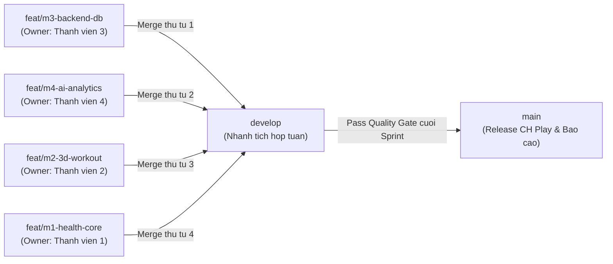
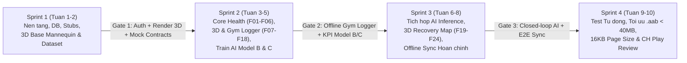

# Lộ trình Phát triển & Quy chuẩn Chống Xung đột Git (Roadmap & Zero-Conflict Workflow)

> **Dự án:** VigorAI (`VigorAI: 3D Gym & Health Log` — Ứng dụng Quản lý Sức khỏe & Luyện tập Gym 3D kết hợp Trí tuệ Nhân tạo)
> **Tài liệu tham chiếu gốc:** [system-design-spec.md](./system-design-spec.md)
> **Bảng kiểm soát công việc chi tiết:** [taskboard.md](./taskboard.md)
> **Quy mô nhóm:** 4 thành viên (`M1`, `M2`, `M3`, `M4`) — **Thời gian:** 10 Tuần (4 Sprints)

---

## 1. Nguyên tắc Phối hợp Song song "Zero Git Conflict"

Trong đồ án có 4 thành viên cùng làm việc trên một kho mã nguồn (**Flutter + FastAPI + AI + Blender 3D**), xung đột Git (Merge Conflict) thường xảy ra ở 4 điểm nóng:
1. Sửa chung file điều hướng (`app_router.dart`) và khởi tạo CSDL (`app_database.dart`) trên Flutter.
2. Sửa chung file cấu hình gói thư viện (`pubspec.yaml`, `requirements.txt`, `AndroidManifest.xml`).
3. Sửa chung file khởi tạo ứng dụng Backend (`main.py`).
4. Commit nhầm file nhị phân nặng hoặc file sinh tự động (`.blend1`, `build/`, `.dart_tool/`, file weight AI `.pt` hàng trăm MB).

Để loại bỏ triệt để tình trạng này và giúp **cả 4 người code song song ngay từ Tuần 1 mà không phải chờ nhau**, dự án áp dụng 3 nguyên tắc bắt buộc:
- **Nguyên tắc 1 — Cô lập Vùng sở hữu (Strict Folder & File Ownership):** Mỗi file mã nguồn chỉ có **01 chủ sở hữu duy nhất (`M1`, `M2`, `M3` hoặc `M4`)**. Thành viên không tự ý sửa trực tiếp file thuộc quyền sở hữu của người khác.
- **Nguyên tắc 2 — Khóa Điểm nóng dùng chung (Shared Stub Locking):** Các file kết nối trung tâm (`app_router.dart`, `app_database.dart`, `main.py`, `pubspec.yaml`, `requirements.txt`, `AndroidManifest.xml`) được khởi tạo và **khóa cấu trúc** ngay trong 2 ngày đầu Sprint 1 bằng cách import sẵn các module tách rời của từng thành viên.
- **Nguyên tắc 3 — Contract-First + Mock Data:** Các hợp đồng JSON API và Schema bảng đã được chốt trong [system-design-spec.md](./system-design-spec.md). M1, M2, M4 làm việc độc lập với dữ liệu giả lập (Mock JSON / SQLite cục bộ / `base_mannequin.glb` mẫu) trong khi M3 dựng Backend thật.

---

## 2. Cấu trúc Thư mục Monorepo & Phân quyền Sở hữu

```text
Gym/
├── .gitignore                          # [LOCKED - M3 khởi tạo Ngày 1] Chặn build/, *.pt nặng, *.blend1
├── docs/                               # [SHARED - Trưởng nhóm điều phối]
│   ├── system-design-spec.md           # Đặc tả thiết kế hệ thống (26 chức năng, ERD, AI, 3D, CH Play)
│   ├── roadmap.md                      # Lộ trình 10 tuần & Quy chuẩn Git Workflow
│   └── taskboard.md                    # Bảng phân chia & theo dõi tiến độ 64 tasks
│
├── mobile/                             # Ứng dụng Flutter (Android / CH Play)
│   ├── pubspec.yaml                    # [LOCKED - Chốt thư viện Sprint 1 Ngày 2]
│   ├── android/app/src/main/
│   │   └── AndroidManifest.xml         # [OWNER: M1] Khóa quyền chuẩn CH Play (F02, F16, F26)
│   ├── assets/3d_bundled/              # [OWNER: M2] Chỉ chứa base_mannequin.glb + 3 bài mẫu (< 4MB)
│   ├── assets/mock_json/               # [SHARED] M1, M2, M4 dùng file JSON riêng (mock_m1.json, ...)
│   └── lib/
│       ├── main.dart                   # [LOCKED - M1 khởi tạo Ngày 1]
│       ├── core/
│       │   ├── theme/                  # [OWNER: M1] app_theme.dart, app_colors.dart
│       │   ├── network/                # [OWNER: M1] dio_client.dart, api_endpoints.dart
│       │   ├── platform/               # [OWNER: M1] photo_picker_service.dart, health_connect_bridge.dart
│       │   ├── sync/                   # [OWNER: M1] sync_queue_manager.dart
│       │   ├── database/
│       │   │   ├── app_database.dart   # [LOCKED STUB] Import 3 file .drift.dart bên dưới
│       │   │   ├── health_tables.drift.dart   # [OWNER: M1]
│       │   │   ├── workout_tables.drift.dart  # [OWNER: M2]
│       │   │   └── ai_cache_tables.drift.dart # [OWNER: M4]
│       │   └── router/
│       │       ├── app_router.dart            # [LOCKED STUB] Gộp 3 danh sách route bên dưới
│       │       ├── health_routes.dart         # [OWNER: M1] Routes cho Auth, F01-F06, F26
│       │       ├── gym3d_workout_routes.dart  # [OWNER: M2] Routes cho F07-F18, F25
│       │       └── ai_analytics_routes.dart   # [OWNER: M4] Routes cho F19-F24
│       └── features/
│           ├── auth_privacy/           # [OWNER: M1] Đăng nhập, Onboarding, Medical Disclaimer, F26
│           ├── health/                 # [OWNER: M1] F01-F06 (Cân nặng, Bước chân, Nước, Calo, Ngủ, Supp)
│           ├── gym3d/                  # [OWNER: M2] F07-F13 + xuất widget Muscle3DViewerWidget (cho F23)
│           ├── workout/                # [OWNER: M2] F14-F18, F25 (Giáo án, Logger, Rest Timer, 1RM, Plate)
│           └── ai_analytics/           # [OWNER: M4] F19-F24 (AI Food UI, Readiness, Volume, Radar, Recovery 3D)
│
├── backend/                            # Máy chủ Python FastAPI + PostgreSQL
│   ├── requirements.txt                # [LOCKED - Chốt thư viện Sprint 1 Ngày 2]
│   ├── docker-compose.yml              # [OWNER: M3] PostgreSQL 16 + MinIO/Object Storage + FastAPI
│   ├── alembic/                        # [OWNER: M3] Database Migrations
│   ├── ai_models/                      # [OWNER: M4] Script tải/load weights (.onnx/.pt/.joblib, không commit file > 50MB)
│   └── app/
│       ├── main.py                     # [LOCKED STUB] Mount sẵn routers của M3 và ai.router của M4
│       ├── core/                       # [OWNER: M3] config.py, security.py (JWT/Argon2), dependencies.py
│       ├── db/                         # [OWNER: M3] session.py, base.py
│       ├── models/                     # [OWNER: M3] 11 bảng nghiệp vụ + food_nutrition_catalog
│       ├── templates/                  # [OWNER: M3] delete_account.html (Trang web xóa tài khoản CH Play)
│       ├── schemas/
│       │   ├── core_schemas.py         # [OWNER: M3] Auth, Sync, Health, Exercises, Workouts
│       │   └── ai_schema.py            # [OWNER: M4] Request/Response cho Model B & Model C
│       ├── services/
│       │   ├── auth_service.py         # [OWNER: M3]
│       │   ├── sync_service.py         # [OWNER: M3] Push/Pull LWW Sync Engine
│       │   ├── storage_service.py      # [OWNER: M3] CDN/S3 Upload & Cascade Delete
│       │   ├── analytics_service.py    # [OWNER: M3] Tổng hợp Volume, Radar, PR
│       │   ├── feature_extractor.py    # [OWNER: M4 phối hợp M3] Trích xuất 12 biến cho Model C
│       │   ├── ai_food_yolo.py         # [OWNER: M4] Suy luận YOLOv8 + quy đổi gam
│       │   └── ai_readiness_ml.py      # [OWNER: M4] Suy luận XGBoost/MLP + Fallback user mới
│       └── routers/
│           ├── auth.py, users.py       # [OWNER: M3] Auth, Export JSON, DELETE /me, GET /delete-account
│           ├── sync.py, health.py      # [OWNER: M3]
│           ├── exercises.py, routines.py, workouts.py, analytics.py # [OWNER: M3]
│           └── ai.py                   # [OWNER: M4] /api/v1/ai/food-analyze & /readiness-and-overload
│
├── ai_research/                        # [OWNER: M4] Môi trường Train & Đánh giá AI (Tách biệt khỏi Backend Runtime)
│   ├── model_b_food_yolo/              # Dataset config, augmentation, train YOLOv8, confusion matrix
│   └── model_c_readiness_ml/           # Bộ sinh dữ liệu Banister, benchmark XGBoost vs LightGBM vs MLP
│
└── assets_3d/                          # [OWNER: M2] Quy trình Blender MCP 3D
    ├── scripts_blender_mcp/            # Script Python bpy dựng Mannequin, Rig, Animation, Draco Export
    ├── source_blend/                   # File .blend gốc (chỉ lưu bản đã chốt, không lưu .blend1/.blend2)
    └── exported_glb/                   # Thư mục xuất .glb nén Draco + assets_manifest.json (SHA-256)
```

### Cách Tách Rời Các Giao Điểm Chung (Zero-Conflict Boundaries)
1. **Giao diện 3D chung cho `F07` (M2) và `F23` (M4):** M2 xây dựng widget độc lập `Muscle3DViewerWidget` (nhận tham số `glbPath`, `muscleColorsMap`, `onMuscleTap`). M4 chỉ cần `import` widget này vào màn hình Phục hồi 3D (`F23`) trong thư mục `ai_analytics/` mà không sửa bất kỳ dòng code nào của M2.
2. **Dịch vụ Photo Picker chung cho `F19` & `F24` (M4):** M1 viết sẵn `PhotoPickerService` (dùng Android Photo Picker + nén ảnh `< 300KB`) trong `core/platform/`. M4 chỉ việc gọi hàm `pickAndCompressImage()` mà không đụng vào quyền Android.
3. **Cập nhật file chung (`pubspec.yaml`, `requirements.txt`, `api_endpoints.dart`):** Nếu phát sinh gói thư viện hoặc endpoint mới sau Tuần 1, thành viên nhắn vào nhóm chung, tạo **1 Micro-PR chỉ sửa đúng file đó**, cả nhóm review & merge ngay trong 15 phút rồi `git pull --rebase` trước khi tiếp tục làm việc.

---

## 3. Quy trình Git Workflow & 5 Quy tắc Vàng

### 3.1. Mô hình Phân nhánh (Branching Model)



- **`main`:** Chỉ chứa code đã chạy ổn định và vượt qua kiểm thử cuối mỗi Sprint (Sprint 1, 2, 3, 4). Bật chế độ bảo vệ nhánh (**Branch Protection**), cấm push trực tiếp.
- **`develop`:** Nhánh tích hợp chung hàng tuần.
- **Nhánh cá nhân:** Đặt tên theo quy ước `feat/m<số>-<tên-task-ngắn>` hoặc `fix/m<số>-<lỗi>` (ví dụ: `feat/m1-health-connect`, `feat/m2-blender-squat`, `feat/m3-sync-api`, `feat/m4-yolo-food`).

### 3.2. Năm Quy tắc Vàng Bắt buộc Tuân thủ
1. **Khóa File Cấu hình Chung từ Tuần 1:** Toàn bộ dependency của Flutter (`drift`, `flutter_riverpod`, `go_router`, `dio`, `health`, `image_picker`, `model_viewer_plus`, `fl_chart`, `workmanager`, `flutter_secure_storage`) và Python (`fastapi`, `sqlalchemy`, `alembic`, `asyncpg`, `ultralytics`, `xgboost`, `lightgbm`, `scikit-learn`, `pydantic`) phải được chốt xong trước ngày thứ 3 của Sprint 1.
2. **Pull bằng Rebase trước khi Push:** Trước khi tạo Pull Request vào `develop`, luôn chạy `git fetch origin && git rebase origin/develop` trên nhánh cá nhân.
3. **Nghiêm cấm `git push --force` lên `main` và `develop`:** Chỉ được phép force-with-lease trên nhánh `feat/m*` của chính mình nếu vừa rebase.
4. **Cấm commit file rác, file build & model AI thô quá nặng:** File `.gitignore` gốc bắt buộc chặn:
   - Flutter/Android: `.dart_tool/`, `build/`, `mobile/android/.gradle/`, `*.apk`, `*.aab`, `*.jks`, `local.properties`
   - Python/AI: `__pycache__/`, `*.pyc`, `.venv/`, `*.pt` / `*.onnx` / `*.pth` trong `ai_research/runs/` (chỉ giữ script train & file manifest tải weight trên Cloud/Release), dữ liệu ảnh dataset thô (`ai_research/datasets/`).
   - Blender: `*.blend1`, `*.blend2`, file render thử nghiệm `.mp4`/`.png` nháp.
5. **Thứ tự Merge Tích hợp Chiều Chủ Nhật (Weekly Integration Sync - 30 phút):**
   Mỗi tuần hợp nhất nhánh theo đúng thứ tự phụ thuộc: **`M3 (Backend API/DB)` $\rightarrow$ `M4 (AI Endpoints & Analytics)` $\rightarrow$ `M2 (3D & Workout)` $\rightarrow$ `M1 (Health Core & App Shell)`**, sau đó chạy smoke test ngay trên `develop` để mọi người bắt đầu tuần mới từ cùng một nền tảng sạch.

---

## 4. Lộ trình Triển khai 10 Tuần (4 Sprints) & Điểm Kiểm soát Tiến độ

### 4.1. Sơ đồ Lộ trình Tổng thể



### 4.2. Chi tiết Kế hoạch Song song theo Sprint

| Sprint | Thời gian | Thành viên 1 (Mobile Core) | Thành viên 2 (3D & Workout) | Thành viên 3 (Backend & DB) | Thành viên 4 (AI & Analytics) | Điểm Kiểm soát (Quality Gate) |
| :--- | :---: | :--- | :--- | :--- | :--- | :--- |
| **Sprint 1** | Tuần 1–2 | Dựng khung Flutter, `AndroidManifest.xml` chuẩn CH Play, SQLite Drift, Onboarding, Auth & Medical Disclaimer (`F26`). | Dựng `base_mannequin.glb` (11 mesh cơ) + 3 bài mẫu qua Blender MCP; tạo `Muscle3DViewerWidget` xoay 360°; Cache Manager. | Dựng Docker + PostgreSQL 16 (12 bảng), Auth JWT, `DELETE /users/me`, trang Web `/delete-account`, Swagger `/docs` + Seed JSON. | Thu thập & gán nhãn Dataset món ăn VN/Gym (Model B); viết bộ sinh dữ liệu Banister 15k mẫu (Model C); tạo stub `/routers/ai.py`. | **Gate 1:** App đăng nhập được Backend thật; Mannequin 3D xoay 360° mượt trên Android; `/delete-account` mở được qua HTTP. |
| **Sprint 2** | Tuần 3–5 | Hoàn thiện `F01`–`F06` (Cân nặng, Health Connect bước chân, Nước bù tập, BMR/TDEE, Giấc ngủ, Supplement) & `SyncQueueManager`. | Dựng 20–30 bài tập 3D + dụng cụ rời; làm `F09`–`F13` (Heatmap cơ, Good/Bad Form, 0.25x, Avatar); làm `F14`–`F18`, `F25` (Logger, Foreground Rest Timer, 1RM, Plate). | Xây dựng `sync/push` & `sync/pull` (LWW), toàn bộ API Health, Exercises CDN + SHA-256, Routines, Workouts & Analytics Summary. | Train xong **Model B (YOLOv8)** đạt `mAP@0.5 >= 0.80`; Train & chọn model tốt nhất **Model C (XGBoost/LightGBM/MLP)** đạt `R2 >= 0.88`; làm UI `F22` & `F24`. | **Gate 2:** Tắt mạng máy bay tập trọn vẹn 1 buổi Gym, bật mạng tự đồng bộ lên PostgreSQL; xem được 20+ bài 3D Good/Bad Form; AI đạt KPI trên tập Test. |
| **Sprint 3** | Tuần 6–8 | Hoàn thiện Trung tâm Quyền riêng tư (`F26`), nối kết quả quét món ăn AI vào Nhật ký Calo (`F04`), test chuyển đổi Offline/Online toàn app. | Gắn thẻ gợi ý tạ của AI Model C (`F21`) vào Live Logger; nâng cấp Gradient màu phục hồi (`F23`) cho `Muscle3DViewerWidget`; tối ưu `>= 45 FPS`. | Viết `feature_extractor.py` (cùng M4), bảo mật HTTPS + Rate Limit, Cascade Delete Object Storage, deploy Staging Server công khai. | Đóng gói API Model B (`/food-analyze`) & Model C (`/readiness-and-overload`) lên FastAPI; làm UI Quét món ăn (`F19`), Thẻ Readiness (`F20`) & Bản đồ Phục hồi 3D (`F23`). | **Gate 3:** Vòng lặp khép kín hoạt động: Chụp đĩa cơm $\rightarrow$ cập nhật Protein $\rightarrow$ Model C đổi điểm Readiness & tô màu mỏi cơ trực tiếp lên Mannequin 3D. |
| **Sprint 4** | Tuần 9–10 | Unit Test công thức (BMI, BMR, Nước); rà soát Merged `AndroidManifest.xml`; hoàn thiện bảng Data Safety & Health Apps Declaration. | Unit Test 1RM & Plate Calculator; build `.aab` kiểm tra `< 40MB` và **16KB page size**; quay video demo & test thực địa phòng Gym. | Pytest toàn bộ API (`Auth`, `Sync`, `Delete Account 401`); Load Test API; kiểm tra Backup DB & uptime `/delete-account`. | Pytest 2 API AI (kèm Fallback user mới); kiểm tra hiển thị Medical Disclaimer dưới AI; xuất biểu đồ đánh giá AI cho báo cáo. | **Gate 4 (CH Play Ready):** `.aab` đạt chuẩn Android 15 (`targetSdk 35`), pass 0 lỗi Policy, hoàn tất Closed Testing (12 testers) trên Play Console. |

---

## 5. Chiến lược Làm việc Độc lập khi Thành viên Khác chưa Xong (Unblock Protocol)

| Tình huống chờ phụ thuộc | Cách giải quyết tức thì để không bị nghẽn |
| :--- | :--- |
| **M1 hoặc M2 cần API khi M3 chưa code xong endpoint** | Dùng `MockInterceptor` của `Dio` đọc file JSON tĩnh trong `mobile/assets/mock_json/` khớp 100% với schema trong [system-design-spec.md](./system-design-spec.md). Chỉ cần bật cờ `const bool useMockApi = false;` khi nối server thật. |
| **M2 cần file `.glb` của 25 bài tập nhưng mới dựng xong 3 bài** | Dùng 3 bài mẫu (`Squat`, `Push-up`, `Bench Press`) làm asset đại diện trong `assets_manifest.json` để hoàn thiện toàn bộ UI thư viện, bộ lọc và `Muscle3DViewerWidget` trước; sau đó chỉ cần cập nhật file `.glb` lên CDN mà không phải sửa code Flutter. |
| **M4 cần màn hình 3D của M2 để ghép Bản đồ Phục hồi `F23`** | M4 test giao diện với Mock Widget khung 3D hiển thị danh sách 11 Material (`Mat_Muscle_*`) và phần trăm màu; đến Sprint 3 chỉ cần thay bằng `Muscle3DViewerWidget` của M2 qua 1 dòng code import. |
| **M1/M2 cần dữ liệu tập luyện lịch sử cho `F22`–`F24` và AI Model C** | M3 viết sẵn script `seed_demo_history.py` tạo 30 ngày dữ liệu tập luyện, bữa ăn, cân nặng, bước chân giả lập trong PostgreSQL (và file SQLite mẫu cho Mobile). |
