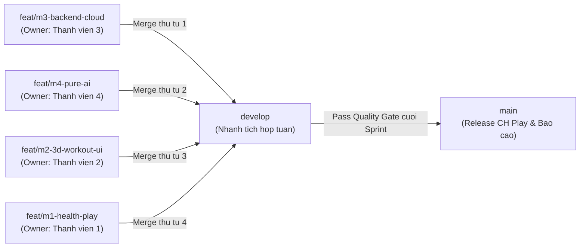
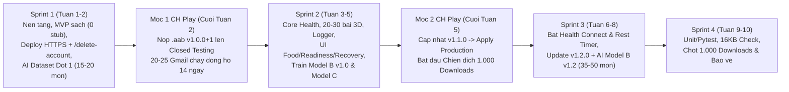

# Lộ trình Phát triển & Quy chuẩn Chống Xung đột Git (Roadmap & Zero-Conflict Workflow)

> **Dự án:** VigorAI (`VigorAI: 3D Gym & Health Log` — Ứng dụng Quản lý Sức khỏe & Luyện tập Gym 3D kết hợp Trí tuệ Nhân tạo)
> **Tài liệu tham chiếu gốc:** [system-design-spec.md](./system-design-spec.md)
> **Bảng kiểm soát công việc chi tiết:** [taskboard.md](./taskboard.md)
> **Quy mô nhóm:** 4 thành viên (`M1`, `M2`, `M3`, `M4`) — **Thời gian:** 10 Tuần (4 Sprints + Phát hành CH Play 2 Nhịp)

---

## 1. Nguyên tắc Phối hợp Song song "Zero Git Conflict"

Trong đồ án có 4 thành viên cùng làm việc trên một kho mã nguồn (**Flutter + FastAPI + AI + Blender 3D**), xung đột Git (Merge Conflict) thường xảy ra ở 4 điểm nóng:
1. Sửa chung file điều hướng (`app_router.dart`) và khởi tạo CSDL (`app_database.dart`) trên Flutter.
2. Sửa chung file cấu hình gói thư viện (`pubspec.yaml`, `requirements.txt`, `AndroidManifest.xml`).
3. Sửa chung file khởi tạo ứng dụng Backend (`main.py`).
4. Commit nhầm file nhị phân nặng hoặc file sinh tự động (`.blend1`, `build/`, `.dart_tool/`, file weight AI `.pt` hàng trăm MB).

Để loại bỏ triệt để tình trạng này và giúp **cả 4 người code song song ngay từ Tuần 1 mà không phải chờ nhau** (đặc biệt tách riêng hoàn toàn Dev AI `M4` khỏi Flutter), dự án áp dụng 3 nguyên tắc bắt buộc:
- **Nguyên tắc 1 — Cô lập Vùng sở hữu (Strict Folder & File Ownership):** Mỗi file mã nguồn chỉ có **01 chủ sở hữu duy nhất (`M1`, `M2`, `M3` hoặc `M4`)**. Riêng `M4` làm **100% Pure AI Engineer (Python Only)**, không code Flutter/Dart; toàn bộ UI Mobile được chia gọn cho `M1` và `M2`.
- **Nguyên tắc 2 — Khóa Điểm nóng dùng chung (Shared Stub Locking):** Các file kết nối trung tâm (`app_router.dart`, `app_database.dart`, `main.py`, `pubspec.yaml`, `requirements.txt`) được khởi tạo và **khóa cấu trúc** ngay trong Sprint 1.
- **Nguyên tắc 3 — Contract-First + Plug-and-Play Cloud AI:** Các hợp đồng JSON API và Schema bảng đã được chốt trong [system-design-spec.md](./system-design-spec.md). Mobile (`M1`, `M2`) dùng Mock JSON làm xong UI sớm, còn `M4` train và cập nhật trọng số Model B/C trực tiếp lên FastAPI Server mà không làm Mobile phải build lại `.aab`.

---

## 2. Cấu trúc Thư mục Monorepo & Phân quyền Sở hữu

```text
Gym/
├── .gitignore                          # [LOCKED] Chặn build/, *.pt nặng, *.blend1
├── AGENTS.md                           # Quy chuẩn bắt buộc cho AI Agent & Team 4 người
├── session_log.md                      # Nhật ký bàn giao các phiên làm việc
├── docs/                               # [SHARED - Trưởng nhóm điều phối]
│   ├── system-design-spec.md           # Đặc tả thiết kế hệ thống (26 chức năng, ERD, AI, 3D, CH Play)
│   ├── roadmap.md                      # Lộ trình 10 tuần, CH Play 2 nhịp & Git Workflow
│   ├── taskboard.md                    # Bảng phân công & theo dõi tiến độ 63 tasks
│   └── chplay_submission_checklist.md  # [OWNER: M1] Hồ sơ Data Safety & Health Declaration
│
├── mobile/                             # Ứng dụng Flutter (Android / CH Play) — M1 & M2 phụ trách
│   ├── pubspec.yaml                    # [LOCKED - Chốt thư viện Sprint 1 Ngày 2]
│   ├── android/
│   │   ├── gradle.properties           # [OWNER: M1]
│   │   ├── settings.gradle.kts         # [OWNER: M1]
│   │   └── app/
│   │       ├── build.gradle.kts        # [OWNER: M1] minSdk 26, targetSdk 35, 16KB page size
│   │       └── src/main/AndroidManifest.xml # [OWNER: M1] Khóa quyền chuẩn CH Play
│   ├── assets/3d_bundled/              # [OWNER: M2] Chỉ chứa base_mannequin.glb + 3 bài mẫu (< 4MB)
│   ├── assets/mock_json/
│   │   ├── mock_m1*.json               # [OWNER: M1] Mock Auth & Health
│   │   ├── mock_m2_exercises.json      # [OWNER: M2] Mock Exercises 3D
│   │   └── mock_m4_ai.json             # [OWNER: M2] Mock AI Readiness/Food cho UI Flutter
│   └── lib/
│       ├── main.dart                   # [LOCKED - M1 khởi tạo Ngày 1]
│       ├── core/
│       │   ├── theme/                  # [OWNER: M1] app_theme.dart, app_colors.dart
│       │   ├── network/                # [OWNER: M1] dio_client.dart, api_endpoints.dart
│       │   ├── platform/               # [OWNER: M1] photo_picker_service.dart, health_connect_bridge.dart
│       │   ├── sync/                   # [OWNER: M1] sync_queue_manager.dart
│       │   ├── database/
│       │   │   ├── app_database.dart          # [LOCKED STUB] Import 3 file .drift.dart bên dưới
│       │   │   ├── health_tables.drift.dart   # [OWNER: M1]
│       │   │   ├── workout_tables.drift.dart  # [OWNER: M2]
│       │   │   └── ai_cache_tables.drift.dart # [OWNER: M2] Cache Readiness & Progress
│       │   └── router/
│       │       ├── app_router.dart            # [LOCKED STUB] Gộp 3 danh sách route bên dưới
│       │       ├── health_routes.dart         # [OWNER: M1] Auth, F01-F06, F19 UI, Ảnh F24, F26
│       │       ├── gym3d_workout_routes.dart  # [OWNER: M2] F07-F18, F25
│       │       └── ai_analytics_routes.dart   # [OWNER: M2] F20-F23 & F24 Radar UI
│       └── features/
│           ├── auth_privacy/           # [OWNER: M1] Onboarding, Login/Register, Xóa tài khoản F26
│           ├── health/                 # [OWNER: M1] F01-F06, food_scan/ (F19 UI), progress_photos/ (F24 Ảnh)
│           ├── gym3d/                  # [OWNER: M2] F07-F13 + Muscle3DViewerWidget
│           ├── workout/                # [OWNER: M2] F14-F18, F25 (Giáo án, Logger, Rest Timer, 1RM, Plate)
│           └── ai_analytics/           # [OWNER: M2] F20/F21 UI, F22 Volume, F23 3D Recovery, F24 Radar
│
├── backend/                            # Máy chủ Python FastAPI + PostgreSQL — M3 & M4 phụ trách
│   ├── requirements.txt                # [LOCKED - Chốt thư viện Sprint 1 Ngày 2]
│   ├── Dockerfile                      # [OWNER: M3]
│   ├── docker-compose.yml              # [OWNER: M3] PostgreSQL 16 + MinIO/Object Storage + FastAPI
│   ├── alembic/                        # [OWNER: M3] Database Migrations
│   ├── ai_models/                      # [OWNER: M4] Script tải/load weights (.onnx/.pt/.joblib)
│   └── app/
│       ├── main.py                     # [LOCKED STUB] Mount sẵn routers của M3 và ai.router của M4
│       ├── core/                       # [OWNER: M3] config.py, security.py (JWT/Argon2)
│       ├── db/                         # [OWNER: M3] session.py, base.py
│       ├── models/                     # [OWNER: M3] 11 bảng nghiệp vụ + food_nutrition_catalog
│       ├── templates/                  # [OWNER: M3] delete_account.html (Trang web xóa tài khoản CH Play)
│       ├── schemas/
│       │   ├── core_schemas.py         # [OWNER: M3] Auth, Sync, Health, Exercises, Workouts
│       │   └── ai_schema.py            # [OWNER: M4] Request/Response cho Model B & Model C
│       ├── services/
│       │   ├── auth_service.py         # [OWNER: M3]
│       │   ├── sync_service.py         # [OWNER: M3] Push/Pull LWW Sync Engine
│       │   ├── storage_service.py      # [OWNER: M3] CDN/S3 Upload & Cascade Delete
│       │   ├── analytics_service.py    # [OWNER: M3] Tổng hợp Volume, Radar, PR
│       │   ├── feature_extractor.py    # [OWNER: M4 phối hợp M3] Trích xuất 12 biến cho Model C
│       │   ├── ai_food_yolo.py         # [OWNER: M4] Suy luận YOLOv8 + quy đổi gam
│       │   └── ai_readiness_ml.py      # [OWNER: M4] Suy luận XGBoost/MLP + Fallback user mới
│       └── routers/
│           ├── auth.py, users.py       # [OWNER: M3] Auth, Export JSON, DELETE /me, GET /delete-account
│           ├── sync.py, health.py      # [OWNER: M3]
│           ├── exercises.py, routines.py, workouts.py, analytics.py # [OWNER: M3]
│           └── ai.py                   # [OWNER: M4] /api/v1/ai/food-analyze & /readiness-and-overload
│
├── ai_research/                        # [OWNER: M4] 100% Pure AI Training & Reports
│   ├── model_b_food_yolo/              # Đợt 1 (15-20 món) -> Đợt 2 (35-50 món) + portion_estimator
│   ├── model_c_readiness_ml/           # Bộ sinh dữ liệu Banister + benchmark XGBoost/LightGBM/MLP
│   └── evaluation_reports/             # Confusion Matrix, mAP, MAE/RMSE/R2 cho báo cáo đồ án
│
└── assets_3d/                          # [OWNER: M2] Quy trình Blender MCP 3D
    ├── scripts_blender_mcp/            # Script Python bpy dựng Mannequin, Rig, Animation, Draco Export
    ├── source_blend/                   # File .blend gốc đã chốt
    └── exported_glb/                   # File .glb nén Draco + assets_manifest.json (SHA-256)
```

### Tách rạch ròi Giao diện UI khỏi Dev AI (`M4`)
1. **`M4` không viết code Flutter:** `M4` chỉ tập trung tìm/lọc dữ liệu, huấn luyện 2 mô hình AI và đóng gói API Python trên `backend/app/routers/ai.py`.
2. **`M1` nhận UI Quét Món ăn (`F19`) & Ảnh Before/After (`F24`):** Vì `M1` đã sở hữu `PhotoPickerService` và Nhật ký Calo (`F04`), nên `M1` tự ghép API `POST /api/v1/ai/food-analyze` và lưu ảnh tiến độ cục bộ rất nhanh.
3. **`M2` nhận UI AI Readiness, Bản đồ Phục hồi 3D (`F20`, `F23`), Volume & Radar (`F22`, `F24`):** Vì `M2` sở hữu `Muscle3DViewerWidget` và bảng buổi tập Gym, `M2` tự truyền `muscle_fatigue_map` từ `GET /api/v1/ai/readiness-and-overload` lên mô hình 3D mà không cần phối hợp sửa file chéo với `M4`.

---

## 3. Quy trình Git Workflow & 5 Quy tắc Vàng

### 3.1. Mô hình Phân nhánh (Branching Model)



- **`main`:** Chỉ chứa code ổn định qua cổng kiểm soát cuối mỗi Sprint/Release.
- **`develop`:** Nhánh tích hợp chung hàng tuần.
- **Nhánh cá nhân:** `feat/m<số>-<tên-task-ngắn>` hoặc `fix/m<số>-<lỗi>` (ví dụ nhánh hiện tại của M1 là `HPhucTV` hoặc `feat/m1-*`).

### 3.2. Năm Quy tắc Vàng Bắt buộc Tuân thủ
1. **Khóa File Cấu hình Chung từ Sprint 1:** Toàn bộ dependency của Flutter (`pubspec.yaml`) và Python (`requirements.txt`) đã khóa; nếu phát sinh thư viện mới, tạo Micro-PR sửa riêng file đó và merge trong 15 phút.
2. **Pull bằng Rebase trước khi Push:** Luôn chạy `git fetch origin && git rebase origin/develop` trước khi mở Pull Request.
3. **Nghiêm cấm `git push --force` lên `main` và `develop`.**
4. **Cấm commit file rác, file build & model AI thô quá nặng:** Chặn qua `.gitignore` (`build/`, `.dart_tool/`, `ai_research/datasets/`, `*.pt` nặng, `*.blend1`, `GeneratedPluginRegistrant.java`).
5. **Thứ tự Merge Tích hợp Chiều Chủ Nhật (30 phút):** **`M3 (Backend)` $\rightarrow$ `M4 (AI APIs)` $\rightarrow$ `M2 (3D & Analytics UI)` $\rightarrow$ `M1 (Health, Food UI & App Shell)`**.

---

## 4. Lộ trình 10 Tuần & Chiến lược Phát hành CH Play 2 Nhịp ("Vừa Code vừa Chạy 14 Ngày")

### 4.1. Sơ đồ Lộ trình Tổng thể & 3 Mốc CH Play



### 4.2. Chi tiết Kế hoạch Song song theo Sprint (Đã tách `M4` Pure AI)

| Sprint | Thời gian | `M1` (Mobile Core, Food/Photo UI & CH Play) | `M2` (3D Blender, Workout, Recovery & Charts) | `M3` (Backend FastAPI, DB & Cloud) | `M4` (100% Pure AI Engineer - Python Only) | Cổng Kiểm soát (Quality Gate) |
| :--- | :---: | :--- | :--- | :--- | :--- | :--- |
| **Sprint 1** *(MVP & Kích hoạt 14 ngày)* | Tuần 1–2 | Xong Core/Auth/Disclaimer/Dashboard; **kéo sớm nút Xóa tài khoản (`F26`) + cờ `FeatureFlags` ẩn stub**; tạm tắt quyền `health.READ_*` ở MVP; mở Play Console (\$25) & gom **20–25 Gmail**. | Dựng `base_mannequin.glb` + 3 bài mẫu qua Blender MCP; làm `Muscle3DViewerWidget`; **build `.aab` MVP `v1.0.0+1`** (`< 40MB`, 16KB page size, 0 stub) đẩy Closed Testing. | Dựng Docker + PostgreSQL 16 (12 bảng), Auth JWT, `DELETE /users/me`, `/delete-account`; **kéo sớm deploy Server HTTPS** (Render/Railway) cho MVP. | **Đợt 1 Model B:** Lọc dataset có sẵn **Roboflow/Kaggle (15–20 món cốt lõi)**; sinh dữ liệu Banister 15k mẫu (Model C); benchmark XGBoost/LightGBM/MLP; xuất API stub `ai.py`. | **Gate 1 (Mốc 1 CH Play):** Bản MVP `v1.0.0+1` đậu kiểm duyệt Closed Testing; link test chạy với 20–25 Gmail bắt đầu đếm **14 ngày liên tục**. |
| **Sprint 2** *(Code trong lúc chờ 14 ngày)* | Tuần 3–5 | Hoàn thiện `F01`, `F03`, `F04`, `F05` (tay), `F06`; xây **UI Quét Món ăn AI (`F19`)** & **Ảnh Before/After cục bộ (`F24`)**; làm `SyncQueueManager`; điều phối đủ 14 ngày test. | Dựng 20–30 bài 3D + dụng cụ; xong `F09`–`F15`, `F17`–`F18`, `F25`; xây **AI Readiness & Phục hồi 3D (`F20`–`F23`)** & **Volume/Radar (`F22`, `F24`)**; xuất `.aab` **`v1.1.0`** xin **Production**. | Xây `sync/push` & `sync/pull` (LWW); xong API Health, Exercises CDN + SHA-256, Routines, Workouts & Analytics Summary. | Train xong **Model B `v1.0` (15–20 món)** & deploy ngay lên FastAPI; train xong **Model C (`R2 >= 0.88`)** + `feature_extractor.py` & deploy API; bắt đầu thu thập ảnh mở rộng **Đợt 2 (35–50 món)**. | **Gate 2 (Mốc 2 CH Play):** Kết thúc 14 ngày Closed Testing $\rightarrow$ đẩy `v1.1.0` (đủ 3D + Logger + AI Food & Readiness, chưa bật Health Connect) lên **Production**. |
| **Sprint 3** *(Full 26 tính năng & 1.000 Tải)* | Tuần 6–8 | Bật lại **Android Health Connect (`F02`, `F05`)** + quay video nộp duyệt; hoàn thiện Trung tâm Quyền riêng tư (`F26`); **chạy Chiến dịch 1.000 lượt tải** trên bản Production `v1.1.0`. | Bật `FOREGROUND_SERVICE_HEALTH` cho **Smart Rest Timer (`F16`)**; tối ưu 3D `>= 45 FPS`; build & đẩy bản cập nhật **`v1.2.0`** (Full 26 chức năng) lên Production. | Gia cố Rate Limiting AI, Cascade Delete Object Storage, cấu hình Backup DB & giám sát server tải cao trong đợt 1.000 downloads. | **Đợt 2 Model B:** Fine-tune **YOLOv8 `v1.2` (35–50 món)** đạt `mAP@0.5 >= 0.80`, cập nhật thẳng weight lên Server (không cần build lại app); kiểm thử chéo thực tế & xuất báo cáo AI. | **Gate 3 (Mốc 3 CH Play):** Bản `v1.2.0` Full 26 chức năng lên kệ CH Play; Model B `v1.2` chạy mượt trên Cloud; chiến dịch tải tiến tới mốc 1.000. |
| **Sprint 4** *(Kiểm thử & Bảo vệ)* | Tuần 9–10 | Unit Test công thức (BMI, BMR, Nước); rà soát Merged Manifest `v1.2.0`; đồng bộ Data Safety & Health Apps Declaration. | Unit Test 1RM & Plate Calculator; kiểm tra 16KB ELF alignment bản cuối; test thực địa Airplane Mode; quay video/screenshot bảo vệ. | Pytest toàn bộ API Core (`Auth`, `Sync`, `Delete 401`); Load Test API; đảm bảo uptime `/delete-account` 24/7. | Pytest 2 API AI (kèm Fallback user mới & Disclaimer); hoàn thiện chương Nghiên cứu AI & demo live trước hội đồng. | **Gate 4 (Hoàn tất Đồ án):** 100% test Pass, app Production ổn định đạt mục tiêu lượt tải, sẵn sàng bảo vệ hội đồng. |

---

## 5. Chiến lược Làm việc Độc lập (Unblock Protocol)

| Tình huống chờ phụ thuộc | Cách giải quyết tức thì để không bị nghẽn |
| :--- | :--- |
| **`M4` đang bận tìm dữ liệu & train AI (`Model B/C`)** | `M1` (UI Quét món ăn `F19`) và `M2` (UI Readiness & Recovery 3D `F20`/`F23`) dùng sẵn `routers/ai.py` stub hoặc `mock_m4_ai.json` để hoàn thiện 100% giao diện. Khi `M4` train xong bản `v1.0` hoặc `v1.2`, chỉ cần thay trọng số trên FastAPI — **không cần sửa code hay build lại `.aab`**. |
| **`M1` hoặc `M2` cần API khi `M3` chưa code xong endpoint** | Dùng `MockApiInterceptor` của `Dio` đọc `mobile/assets/mock_json/`. Chỉ cần truyền `--dart-define=USE_MOCK_API=false` khi nối server thật. |
| **Chưa duyệt xong quyền Health Connect trên Google Play** | Bản Closed Testing `v1.0.0+1` và Production `v1.1.0` tạm ẩn quyền Health Connect để mở khóa kênh tải 1.000 lượt ngay; sau đó mới gửi bản `v1.2.0` bật Health Connect kèm video minh họa. |
