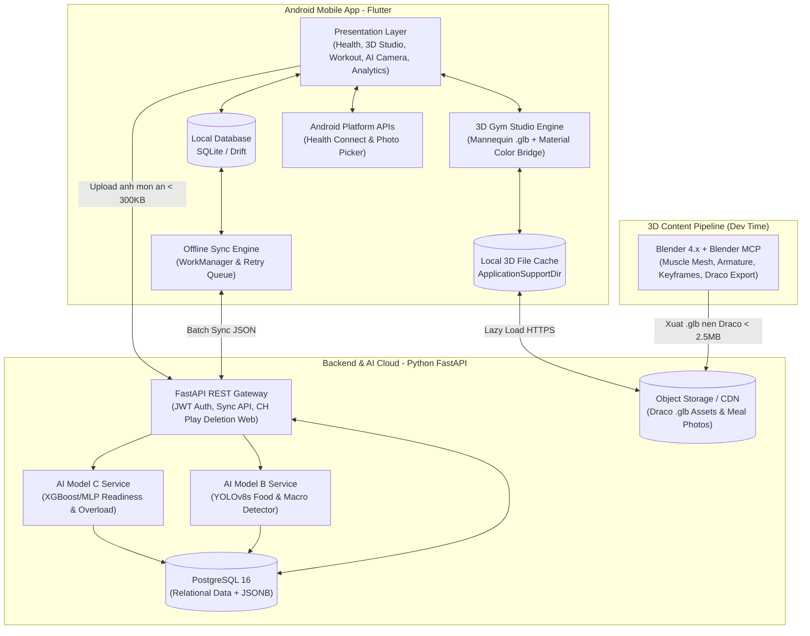
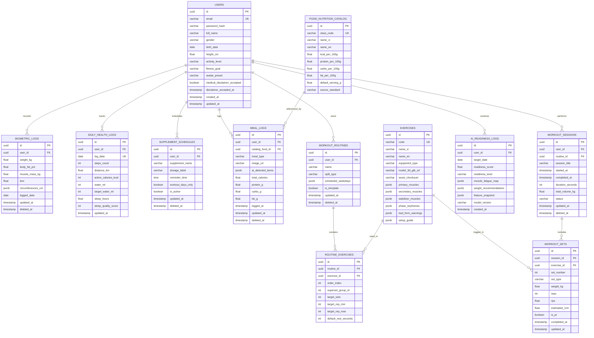

# Đặc tả Thiết kế Hệ thống: VigorAI

> **Tên đề tài đầy đủ:** *VigorAI — Ứng dụng Quản lý Sức khỏe & Luyện tập Gym 3D kết hợp Trí tuệ Nhân tạo*
> **Tiêu đề Google Play (CH Play):** `VigorAI: 3D Gym & Health Log`
> **Tài liệu Thiết kế Hệ thống & Đặc tả Yêu cầu (SRS & SAD)**
> **Phiên bản:** 1.0.0
> **Ngày phát hành:** 18/11/2026
> **Quy mô nhóm thực hiện:** 4 thành viên (Đồ án Chuyên ngành / Tốt nghiệp)
> **Nền tảng mục tiêu:** Android Mobile App (Flutter) phát hành chính thức trên **Google Play Store (CH Play)** + Backend **Python FastAPI** + **PostgreSQL** + **Blender MCP 3D Pipeline**

---

## Mục lục

1. [Tổng quan Dự án & Mục tiêu Hệ thống](#1-tổng-quan-dự-án--mục-tiêu-hệ-thống)
2. [Kiến trúc Hệ thống Tổng thể & Đồng bộ Offline-First](#2-kiến-trúc-hệ-thống-tổng-thể--đồng-bộ-offline-first)
3. [Đặc tả Chi tiết 26 Chức năng Hệ thống (F01 – F26)](#3-đặc-tả-chi-tiết-26-chức-năng-hệ-thống-f01--f26)
4. [Thiết kế Cơ sở Dữ liệu PostgreSQL (ERD & Schema Chi tiết)](#4-thiết-kế-cơ-sở-dữ-liệu-postgresql-erd--schema-chi-tiết)
5. [Đặc tả Kỹ thuật 2 Mô hình AI Tự Huấn luyện (Model B & Model C)](#5-đặc-tả-kỹ-thuật-2-mô-hình-ai-tự-huấn-luyện-model-b--model-c)
6. [Quy trình Kỹ thuật 3D với Blender MCP](#6-quy-trình-kỹ-thuật-3d-với-blender-mcp)
7. [Đặc tả Danh mục RESTful API (FastAPI)](#7-đặc-tả-danh-mục-restful-api-fastapi)
8. [Hồ sơ Tuân thủ Chính sách Google Play Store (CH Play)](#8-hồ-sơ-tuân-thủ-chính-sách-google-play-store-ch-play)
9. [Lộ trình Triển khai theo Giai đoạn (Sprint Roadmap)](#9-lộ-trình-triển-khai-theo-giai-đoạn-sprint-roadmap)

---

## 1. Tổng quan Dự án & Mục tiêu Hệ thống

### 1.1. Bối cảnh và Tên Hệ thống
**VigorAI** (*VigorAI: 3D Gym & Health Log*) là hệ sinh thái ứng dụng di động tích hợp **Quản lý sức khỏe toàn diện**, **Hướng dẫn luyện tập Gym bằng mô hình 3D tương tác (Blender MCP)** và **Trợ lý AI cá nhân hóa** (Nhận diện dinh dưỡng qua ảnh chụp + Dự báo mức độ phục hồi & đề xuất tải trọng tập luyện).

Dự án giải quyết 3 vấn đề cốt lõi của người tập Gym tại Việt Nam:
1. Người mới tập khó hình dung kỹ thuật chuẩn, góc mở khớp và nhóm cơ đang chịu lực khi chỉ xem ảnh 2D hoặc video quay một góc.
2. Việc ghi chép calo/macro và nhật ký tập luyện rời rạc giữa nhiều ứng dụng; mất mạng trong phòng Gym làm gián đoạn quá trình nhập hiệp tập.
3. Không biết khi nào cơ thể bị quá tải (Overtraining) để điều chỉnh mức tạ phù hợp với chế độ ăn, giấc ngủ và vận động trong ngày.

### 1.2. Bộ Công nghệ (Tech Stack)

| Tầng hệ thống | Công nghệ sử dụng | Lý do lựa chọn |
| :--- | :--- | :--- |
| **Mobile App** | **Flutter (Dart 3.x)**, Riverpod/BLoC, **Drift (SQLite)** | Hiệu năng cao trên Android, build chuẩn `.aab`, hỗ trợ Offline-First mạnh mẽ. |
| **3D Engine (Mobile)** | `model_viewer_plus` / WebGL `<model-viewer>` JS Bridge (hoặc Filament) | Hỗ trợ file `.glb` nén Draco từ Blender, xoay 360°, tua animation và đổi màu vật liệu từng bó cơ theo thời gian thực. |
| **3D Authoring Pipeline** | **Blender 4.x + Blender MCP** (Python `bpy`) | Tự động hóa dựng Mannequin phân vùng cơ, gắn xương (Rigging), Keyframe chuẩn/lỗi sai và xuất `.glb`. |
| **Backend API** | **Python 3.11+ / FastAPI**, SQLAlchemy 2.0 (Async), Alembic, Pydantic v2 | Đồng nhất ngôn ngữ với AI Inference, hiệu năng Async cao, tự sinh Swagger `/docs`. |
| **Cơ sở dữ liệu Cloud** | **PostgreSQL 16** (hỗ trợ `UUID`, `JSONB`) | Chuẩn hóa quan hệ Sức khỏe – Tập luyện, `JSONB` lưu linh hoạt metadata 3D & kết quả AI. |
| **AI / Machine Learning** | **Model B:** YOLOv8s/m (PyTorch/Ultralytics)<br>**Model C:** XGBoost / LightGBM / MLP (Scikit-learn) | Phù hợp thế mạnh của thành viên AI, dễ đo lường chỉ số khoa học (`mAP`, `MAE`, `RMSE`, `R2`). |
| **Lưu trữ Tài nguyên** | **Object Storage / CDN** (Cloudflare R2 / AWS S3 / MinIO) | Lưu file 3D `.glb` và ảnh bữa ăn ngoài bộ cài để giữ kích thước `.aab` nhỏ gọn (`< 40 MB`). |

### 1.3. Phân công Trách nhiệm cho Team 4 Người

| Thành viên | Vai trò chính | Các phân hệ & Đầu việc phụ trách |
| :--- | :--- | :--- |
| **Thành viên 1** | **Mobile Core, Health, Food/Photo UI & CH Play (Flutter)** | - Thiết kế UI/UX chính, Auth, Onboarding, nút Xóa tài khoản & Trung tâm Quyền riêng tư CH Play (`F26`), điều phối Closed Testing & hồ sơ Play Console.<br>- Phân hệ Quản lý Sức khỏe (`F01` – `F06`): Health Connect (bật ở bản `v1.2.0`), bước chân, lượng nước, BMR/TDEE, giấc ngủ, Supplement.<br>- UI **Quét Món ăn AI (`F19`)** & **Ảnh Before/After cục bộ (`F24`)** dùng `PhotoPickerService`.<br>- Cơ sở dữ liệu cục bộ **SQLite (Drift)** & Hàng đợi đồng bộ (Sync Queue). |
| **Thành viên 2** | **3D Blender MCP, Workout, Recovery 3D & Charts (Flutter)** | - Thiết kế và xuất bộ tài nguyên 3D (`base_mannequin.glb`, bộ dụng cụ rời, animation đúng/sai) qua **Blender MCP**.<br>- Xây dựng 3D Gym Studio Viewer (`F07` – `F13`) và màn hình **AI Readiness & Bản đồ Phục hồi 3D (`F20`, `F21`, `F23`)** bằng `Muscle3DViewerWidget`.<br>- Luồng thực thi buổi tập Gym (`F14` – `F18`, `F25`) và biểu đồ **Volume Load, Radar cân bằng cơ (`F22`, `F24`)** + đóng gói `.aab` 16KB page size. |
| **Thành viên 3** | **Backend, Database Architect & Cloud Deploy (FastAPI + PostgreSQL)** | - Thiết kế Schema **PostgreSQL**, viết Migration (Alembic) và toàn bộ RESTful API cốt lõi trên **FastAPI**.<br>- Xây dựng cơ chế đồng bộ hai chiều (Offline-Online Sync), JWT Auth, dịch vụ lưu trữ Object Storage/CDN cho file `.glb`.<br>- Xây dựng trang Web tĩnh **Xóa tài khoản công khai** (`GET /delete-account`), API xóa dữ liệu (`DELETE /api/v1/users/me`) và **deploy Server HTTPS ngay Sprint 1** phục vụ Closed Testing. |
| **Thành viên 4** | **100% Pure AI Engineer (Python Only)** | - Tập trung toàn lực vào dữ liệu và huấn luyện **AI Model B** (YOLOv8 nhận diện món ăn theo 2 đợt: Đợt 1 `15–20 món`, Đợt 2 `35–50 món`) & **AI Model C** (XGBoost/LightGBM/MLP dự báo Readiness & Overload từ dữ liệu Banister).<br>- Đóng gói Model Inference Endpoints trên FastAPI (`POST /api/v1/ai/food-analyze`, `GET /api/v1/ai/readiness-and-overload`) & `test_ai_api.py`.<br>- Xuất số liệu/biểu đồ đánh giá AI cho báo cáo đồ án (không code Flutter). |

---

## 2. Kiến trúc Hệ thống Tổng thể & Đồng bộ Offline-First

### 2.1. Sơ đồ Kiến trúc Tổng thể (Hybrid Offline-First + Cloud AI & Dynamic 3D)

Hệ thống áp dụng kiến trúc **Hybrid Offline-First**: mọi thao tác ghi nhận sinh trắc học và tập luyện tại phòng Gym được ưu tiên ghi trực tiếp vào SQLite cục bộ (0ms độ trễ, không phụ thuộc 4G/Wi-Fi), sau đó đồng bộ ngầm lên PostgreSQL. Các tác vụ suy luận AI nặng và tài nguyên 3D mở rộng được đặt trên Cloud và có bộ đệm (Cache) thông minh.



### 2.2. Cơ chế Đồng bộ Hai chiều Offline-First (Bidirectional Sync)

1. **Định danh toàn cục phía Client:** Mọi bản ghi tạo mới trên Flutter (`workout_sessions`, `workout_sets`, `biometric_logs`, `daily_health_logs`, `meal_logs`, `workout_routines`) đều tự sinh khóa chính **UUID v4** ngay trên điện thoại.
2. **Trạng thái đồng bộ trên SQLite:** Mỗi bảng cục bộ có thêm 3 cột kỹ thuật:
   - `sync_status`: `SYNCED` | `PENDING_CREATE` | `PENDING_UPDATE` | `PENDING_DELETE`
   - `updated_at`: Thời gian cập nhật gần nhất theo chuẩn UTC ISO-8601.
   - `deleted_at`: Soft-delete timestamp (đánh dấu xóa mềm để đồng bộ lệnh xóa lên server).
3. **Luồng đẩy dữ liệu (Push Sync - `POST /api/v1/sync/push`):**
   - Kích hoạt tự động khi kết thúc buổi tập, khi có kết nối mạng trở lại (`connectivity_plus`), hoặc qua tác vụ nền `WorkManager` mỗi 6 giờ.
   - Gom tất cả bản ghi có `sync_status != SYNCED` gửi theo lô (Batch) lên FastAPI. Server xử lý trong 1 Database Transaction và trả về danh sách ID đã xác nhận để Flutter chuyển về `SYNCED`.
4. **Luồng kéo dữ liệu (Pull Sync - `GET /api/v1/sync/pull?since={last_sync_utc}`):**
   - Lấy toàn bộ bản ghi thay đổi trên PostgreSQL kể từ lần đồng bộ cuối cùng (hỗ trợ đăng nhập lại trên thiết bị mới).
5. **Giải quyết Xung đột (Conflict Resolution):**
   - Áp dụng chiến lược **Last-Write-Wins (LWW)** dựa trên `updated_at` (UTC). Nếu cùng một bản ghi bị sửa ở hai nơi trước khi đồng bộ, bản ghi có `updated_at` mới hơn sẽ ghi đè; với dữ liệu nhật ký cộng dồn theo ngày (`daily_health_logs`), lấy giá trị lớn hơn cho `steps_count` (từ Health Connect) để tránh mất dữ liệu bước chân.

### 2.3. Chiến lược Lưu trữ & Tải Tài nguyên 3D (Dynamic 3D Caching)
- **Đóng gói sẵn trong APK/AAB:** Chỉ nhúng duy nhất mô hình cơ sở `base_mannequin.glb` (~1.8 MB) và 3 bài tập mẫu (Squat, Push-up, Bench Press) để đảm bảo kích thước `.aab` gốc luôn dưới `40 MB` và người dùng có thể dùng thử ngay khi vừa cài đặt.
- **Lazy Loading & LRU Cache:** Các bài tập còn lại và dụng cụ mở rộng tải từ CDN khi người dùng mở chi tiết bài tập lần đầu, lưu vào `getApplicationSupportDirectory()/3d_assets/` kèm kiểm tra mã băm SHA-256 (`asset_checksum`) để cập nhật phiên bản mới khi cần, giới hạn dung lượng cache tối đa `250 MB` theo cơ chế LRU (xóa file ít dùng nhất khi đầy).

---

## 3. Đặc tả Chi tiết 26 Chức năng Hệ thống (F01 – F26)

### 3.1. Phân hệ 1: Quản lý Sức khỏe & Sinh trắc học (F01 – F06)

#### F01. Theo dõi Cân nặng & Thành phần Cơ thể (Body Composition)
- **Đầu vào (Input):** Cân nặng (`weight_kg`), chiều cao (`height_cm`), tỷ lệ mỡ (`body_fat_pct` - tùy chọn), khối lượng cơ (`muscle_mass_kg` - tùy chọn), số đo 5 vòng (`ngực`, `eo`, `mông`, `bắp tay`, `đùi` tính bằng cm), ngày ghi nhận.
- **Xử lý & Công thức (Process/Logic):**
  - Tự động tính chỉ số BMI: $\text{BMI} = \frac{\text{weight\_kg}}{(\text{height\_cm} / 100)^2}$.
  - Phân loại ngưỡng BMI chuẩn Châu Á (WHO Asia-Pacific): Thiếu cân (`< 18.5`), Bình thường (`18.5 – 22.9`), Thừa cân (`23.0 – 24.9`), Béo phì (`>= 25.0`).
  - Tính đường trung bình trượt 7 ngày (7-Day Moving Average) để loại bỏ nhiễu dao động nước trong cơ thể.
- **Đầu ra (Output):** Biểu đồ đường biến động cân nặng thực tế kèm đường xu hướng 7 ngày, bảng chỉ số BMI và độ thay đổi số đo các vòng theo tuần/tháng.
- **Tiêu chí nghiệm thu (Acceptance Criteria):** Nhập cân nặng hoạt động mượt mà ở chế độ Offline; biểu đồ cập nhật ngay trong `< 200ms`; tính đúng BMI với sai số làm tròn 1 chữ số thập phân.

#### F02. Đếm bước chân & Vận động hàng ngày (Step & NEAT Tracker)
- **Đầu vào (Input):** Dữ liệu bước chân (`StepsRecord`), quãng đường (`DistanceRecord`) và năng lượng tiêu hao chủ động (`ActiveCaloriesBurnedRecord`) từ **Android Health Connect API**; dữ liệu cảm biến gia tốc (`TYPE_STEP_COUNTER`) dự phòng khi thiết bị chưa cấp quyền Health Connect.
- **Xử lý & Công thức (Process/Logic):**
  - Đồng bộ theo ngày (`log_date`), khử trùng lặp (Deduplication) theo nguồn ưu tiên `Health Connect > Sensor Pedometer`.
  - Nếu tính từ cảm biến phần cứng: $\text{Distance (km)} = \text{Steps} \times \text{StrideLength (m)} / 1000$, với $\text{StrideLength} \approx \text{height\_cm} \times 0.415 / 100$.
  - Tính % hoàn thành mục tiêu ngày (mặc định `8,000` bước, cho phép tùy chỉnh từ `3,000 – 20,000` bước).
- **Đầu ra (Output):** Vòng tròn tiến độ bước chân trên Dashboard, số km đã đi và lượng kcal tiêu hao từ NEAT.
- **Tiêu chí nghiệm thu (Acceptance Criteria):** Xin quyền `ACTIVITY_RECOGNITION` và Health Connect đúng thời điểm người dùng bật tính năng (kèm màn hình giải thích); số bước khớp với Google Fit / Health Connect với độ lệch `< 2%`.

#### F03. Theo dõi Lượng nước Thông minh (Smart Hydration)
- **Đầu vào (Input):** Cân nặng hiện tại (`weight_kg`), các lần bấm thêm nước (`+150ml`, `+250ml`, `+500ml` hoặc tùy chỉnh), trạng thái buổi tập Gym trong ngày (thời lượng phút & cường độ RPE).
- **Xử lý & Công thức (Process/Logic):**
  - Lượng nước nền hàng ngày: $\text{BaseWater (ml)} = 35 \times \text{weight\_kg}$.
  - Tự động cộng bù lượng nước mất qua mồ hôi khi ghi nhận buổi tập Gym trong ngày: cộng `+500 ml` cho buổi tập vừa (`RPE < 7` hoặc `< 60 phút`), hoặc `+750 ml` cho buổi tập nặng (`RPE >= 7` hoặc `>= 60 phút`).
  - Lên lịch nhắc nhở uống nước bằng `WorkManager` (khoảng cách mỗi 2 tiếng trong khung giờ thức `07:00 – 21:30`).
- **Đầu ra (Output):** Thanh tiến độ mực nước trực quan, tổng ml đã uống / mục tiêu đã điều chỉnh theo buổi tập, thông báo nhắc nhở nhẹ nhàng.
- **Tiêu chí nghiệm thu (Acceptance Criteria):** Khi hoàn thành một buổi tập 60 phút RPE 8, mục tiêu nước trong ngày tự động tăng thêm `750 ml` và hiển thị rõ lý do bù nước; không sử dụng quyền `SCHEDULE_EXACT_ALARM`.

#### F04. Nhật ký Calo & Dinh dưỡng Đa lượng (Calorie & Macro Tracker)
- **Đầu vào (Input):** Tuổi, giới tính, chiều cao, cân nặng, mức độ vận động (`Sedentary` 1.2, `Light` 1.375, `Moderate` 1.55, `Active` 1.725, `Very Active` 1.9), mục tiêu (`BULK`, `CUT`, `MAINTAIN`), các bữa ăn trong ngày (nhập tay, chọn từ danh mục hoặc nhận diện từ AI Model B).
- **Xử lý & Công thức (Process/Logic):**
  - Tính **BMR** theo công thức **Mifflin-St Jeor**:
    - Nam: $\text{BMR} = 10 \times W + 6.25 \times H - 5 \times A + 5$
    - Nữ: $\text{BMR} = 10 \times W + 6.25 \times H - 5 \times A - 161$
  - Tính **TDEE**: $\text{TDEE} = \text{BMR} \times \text{ActivityFactor}$.
  - Mục tiêu Calo theo chế độ:
    - `BULK` (Tăng cơ): $\text{TargetKcal} = \text{TDEE} + 300$
    - `CUT` (Giảm mỡ): $\text{TargetKcal} = \max(\text{BMR}, \text{TDEE} - 400)$
    - `MAINTAIN` (Giữ dáng): $\text{TargetKcal} = \text{TDEE}$
  - Phân bổ Macro chuẩn thể hình:
    - **Protein:** $2.0 \text{ g/kg}$ cân nặng (`1g = 4 kcal`).
    - **Fat:** $25\%$ tổng `TargetKcal` (`1g = 9 kcal`).
    - **Carbs:** $(\text{TargetKcal} - \text{ProteinKcal} - \text{FatKcal}) / 4$ (`1g = 4 kcal`).
- **Đầu ra (Output):** Tổng Calo nạp vào / còn lại, 3 thanh tiến độ Macro (`Protein / Carb / Fat`) theo gam và phần trăm, nhật ký chia theo 4 bữa (`Sáng / Trưa / Tối / Phụ`).
- **Tiêu chí nghiệm thu (Acceptance Criteria):** Công thức BMR/TDEE tính chính xác 100% theo đơn vị kiểm thử (Unit Test); hiển thị kèm trích dẫn nguồn công thức Mifflin-St Jeor.

#### F05. Theo dõi Giấc ngủ & Phục hồi Nền (Sleep Tracker)
- **Đầu vào (Input):** Giờ đi ngủ (`bed_time`), giờ thức dậy (`wake_time`), chất lượng cảm nhận (1–5 sao) hoặc đồng bộ tự động `SleepSessionRecord` từ Android Health Connect.
- **Xử lý & Công thức (Process/Logic):** Tính tổng thời lượng ngủ (`sleep_hours`), phát hiện thiếu ngủ (`< 6.5 giờ`) và đưa làm đặc trưng đầu vào cho AI Model C.
- **Đầu ra (Output):** Biểu đồ cột thời lượng ngủ 7 ngày gần nhất và đánh giá trạng thái ngủ (`Thiếu ngủ`, `Đạt chuẩn 7–9h`, `Ngủ bù`).
- **Tiêu chí nghiệm thu (Acceptance Criteria):** Hỗ trợ nhập tay trong 2 chạm hoặc đồng bộ tự động từ Health Connect; dữ liệu được đồng bộ vào bảng `daily_health_logs`.

#### F06. Nhắc lịch Thực phẩm Bổ sung (Supplement Reminder)
- **Đầu vào (Input):** Tên thực phẩm (Whey Protein, Creatine Monohydrate, Pre-Workout, Omega-3, Multivitamin), liều lượng (gram/muỗng/viên), khung giờ nhắc, tần suất hàng ngày hoặc chỉ ngày có lịch tập.
- **Xử lý & Công thức (Process/Logic):** Lưu lịch vào bảng `supplement_schedules`, đăng ký `WorkManager` Periodic Work kiểm tra và bắn Local Notification kèm nút hành động nhanh **"Đã uống"** ngay trên thanh thông báo.
- **Đầu ra (Output):** Danh sách checklist thực phẩm bổ sung trong ngày và tỷ lệ tuân thủ theo tuần.
- **Tiêu chí nghiệm thu (Acceptance Criteria):** Nhấn "Đã uống" trên notification cập nhật ngay trạng thái vào SQLite mà không cần mở toàn bộ ứng dụng; thông báo hoạt động ổn định trên Android 13/14/15 với quyền `POST_NOTIFICATIONS`.

---

### 3.2. Phân hệ 2: Phòng Tập 3D Tương tác với Blender MCP (F07 – F13)

#### F07. Thư viện Bài tập 3D Tương tác (Interactive 3D Exercise Library)
- **Đầu vào (Input):** Từ khóa tìm kiếm, bộ lọc theo nhóm cơ (Ngực, Lưng, Vai, Tay, Chân, Bụng) và loại dụng cụ (`Barbell`, `Dumbbell`, `Cable`, `Machine`, `Bodyweight`).
- **Xử lý & Công thức (Process/Logic):** Truy vấn bảng `exercises` trong SQLite cục bộ; tải file `.glb` tương ứng từ `Local Cache` (nếu có) hoặc lazy-load từ CDN và lưu cache.
- **Đầu ra (Output):** Màn hình chi tiết bài tập hiển thị mô hình 3D Mannequin thực hiện động tác chuẩn liên tục kèm hướng dẫn từng bước bằng văn bản.
- **Tiêu chí nghiệm thu (Acceptance Criteria):** Thời gian mở và render mô hình 3D đã cache `< 1.2 giây`; tốc độ khung hình duy trì `>= 45 FPS` trên thiết bị Android tầm trung (RAM 4GB).

#### F08. Điều khiển Camera 3D 360° & Đa góc nhìn Cố định
- **Đầu vào (Input):** Thao tác chạm kéo 1 ngón (Orbit 360°), chụm/tách 2 ngón (Pinch-to-Zoom), hoặc bấm nút chọn góc nhìn nhanh (`Front`, `Side`, `Back`, `Top`).
- **Xử lý & Công thức (Process/Logic):** Gửi tham số `camera-orbit` (góc phương vị `theta`, góc ngẩng `phi`, bán kính `radius`) qua JS Bridge / Controller tới 3D Viewer với nội suy chuyển động mượt (Smooth camera interpolation).
- **Đầu ra (Output):** Góc nhìn 3D xoay tức thời theo cử chỉ tay hoặc chuyển đúng góc giải phẫu yêu cầu để quan sát độ thẳng lưng và quỹ đạo thanh tạ (Bar Path).
- **Tiêu chí nghiệm thu (Acceptance Criteria):** Xoay 360° không bị giật hoặc mất tâm nhân vật; 4 nút góc nhìn cố định chuyển góc chính xác trong `300ms`.

#### F09. Bản đồ Giải phẫu Cơ bắp 3D (3D Muscle Heatmap)
- **Đầu vào (Input):** Danh sách `primary_muscles`, `secondary_muscles`, `stabilizer_muscles` từ metadata của bài tập hiện tại.
- **Xử lý & Công thức (Process/Logic):** Duyệt qua các vật liệu đặt tên chuẩn `Mat_Muscle_*` trong mô hình `.glb` và thay đổi thuộc tính `BaseColorFactor` + độ phát sáng nhẹ (`EmissiveFactor`):
  - **Cơ chính (Primary):** Đỏ `#E53935`
  - **Cơ phụ (Secondary):** Cam `#FB8C00`
  - **Cơ giữ thăng bằng (Stabilizer):** Vàng `#FDD835`
  - **Cơ không tham gia:** Xám trung tính `#9E9E9E`
- **Đầu ra (Output):** Mô hình Mannequin 3D hiển thị nổi bật chính xác các nhóm cơ đang chịu tải ngay khi thực hiện animation, kèm chú thích tên từng nhóm cơ khi người dùng chạm chọn.
- **Tiêu chí nghiệm thu (Acceptance Criteria):** Màu sắc trên các mesh `Muscle_*` cập nhật đồng bộ theo đúng từng bài tập mà không cần tải lại file `.glb`.

#### F10. Mô phỏng Tư thế Đúng vs. Lỗi Sai Phổ biến (3D Good vs. Bad Form)
- **Đầu vào (Input):** Công tắc chuyển đổi chế độ **`Tư thế Chuẩn` (`Anim_GoodForm`)** và **`Lỗi sai cần tránh` (`Anim_BadForm`)** trên màn hình 3D Viewer.
- **Xử lý & Công thức (Process/Logic):** Chuyển đổi Animation Clip đang phát bên trong file `.glb` và bật lớp phủ cảnh báo giải thích điểm rủi ro chấn thương (ví dụ: lưng dưới cong khi Deadlift, đầu gối chụm vào trong khi Squat).
- **Đầu ra (Output):** Mô hình 3D chuyển ngay sang động tác sai kèm viền/điểm nhấn màu cảnh báo tại vùng khớp gặp áp lực sai và hộp thoại hướng dẫn cách khắc phục.
- **Tiêu chí nghiệm thu (Acceptance Criteria):** Ít nhất 15 bài tập Compound/Chủ lực có đủ cả 2 clip `Anim_GoodForm` và `Anim_BadForm` chuyển đổi mượt mà không bị nhấp nháy khung hình.

#### F11. Điều khiển Tốc độ & Phân tách Pha Chuyển động (3D Tempo & Phase Control)
- **Đầu vào (Input):** Nút chọn tốc độ (`0.25x`, `0.5x`, `1.0x`), nút Play/Pause, thanh trượt thời gian (Timeline Scrubber) và nút nhảy pha (`Eccentric`, `Isometric`, `Concentric`).
- **Xử lý & Công thức (Process/Logic):** Điều chỉnh thuộc tính `timeScale` của Animation Mixer; đọc metadata phân đoạn keyframe của từng bài (ví dụ: `0%–45%`: Hạ tạ – Hít vào; `45%–55%`: Giữ đỉnh; `55%–100%`: Phát lực – Thở ra) để hiển thị nhãn pha động theo thời gian thực.
- **Đầu ra (Output):** Người tập xem chậm từng mili-giây điểm chuyển pha và đồng bộ đúng nhịp hít thở.
- **Tiêu chí nghiệm thu (Acceptance Criteria):** Khi tua thanh trượt hoặc chọn tốc độ `0.25x`, nhãn pha chuyển động và chỉ dẫn "Hít vào / Thở ra" cập nhật khớp với tư thế của mô hình 3D.

#### F12. Bộ Dụng cụ Gym 3D Rời (Modular 3D Equipment Setup)
- **Đầu vào (Input):** Bài tập có thuộc tính `equipment_type` (`BARBELL`, `DUMBBELL`, `BENCH`, `CABLE`, `RACK`, `KETTLEBELL`).
- **Xử lý & Công thức (Process/Logic):** Trong Blender MCP, dụng cụ được chuẩn hóa gắn vào các Socket xương (`Socket_Hand_L`, `Socket_Hand_R`, `Socket_Back_Barbell`) hoặc đặt cố định theo gốc tọa độ mặt sàn (`Floor_Origin`), kèm thông số thiết lập thực tế (độ cao ghế `30°/45°/0°`, vị trí chốt rack, độ cao ròng rọc).
- **Đầu ra (Output):** Mô hình 3D hiển thị đầy đủ nhân vật phối hợp cùng dụng cụ chuẩn tỷ lệ và thẻ thông số Setup máy trước khi tập.
- **Tiêu chí nghiệm thu (Acceptance Criteria):** Dụng cụ không bị xuyên thấu (Clipping) qua tay/vai nhân vật trong suốt chu kỳ animation; kích thước dụng cụ chuẩn tỷ lệ người thật.

#### F13. Tùy biến Tỷ lệ Mô hình 3D (3D Body Avatar)
- **Đầu vào (Input):** Tùy chọn hình thể trong Cài đặt (`Nam - Thể hình chuẩn`, `Nữ - Fitness`, `Nam - Cơ bắp cao`) hoặc lấy mặc định từ giới tính trong hồ sơ người dùng.
- **Xử lý & Công thức (Process/Logic):** Áp dụng giá trị Morph Target / Blend Shape hoặc chọn biến thể `base_mannequin_male.glb` / `base_mannequin_female.glb` giữ nguyên bộ xương `Armature_GymHuman` để dùng chung toàn bộ Animation Clips.
- **Đầu ra (Output):** Nhân vật hướng dẫn 3D phản ánh đúng giới tính/tỷ lệ cơ thể mà người dùng lựa chọn.
- **Tiêu chí nghiệm thu (Acceptance Criteria):** Thay đổi Avatar không làm lệch vị trí nắm tạ hoặc hỏng animation của các bài tập hiện có.

---

### 3.3. Phân hệ 3: Lập Kế hoạch & Thực thi Buổi tập Gym (F14 – F18)

#### F14. Lịch tập luyện & Thiết kế Giáo án (Routine & Split Builder)
- **Đầu vào (Input):** Tên giáo án, ngày tập trong tuần, danh sách bài tập được chọn kèm số hiệp mục tiêu (`target_sets`), khoảng rep mục tiêu (`target_rep_min – target_rep_max`), hoặc chọn từ 4 mẫu chuẩn sẵn có (`Push-Pull-Legs`, `Upper-Lower`, `Full Body`, `Bro Split`).
- **Xử lý & Công thức (Process/Logic):** Lưu cấu trúc vào `workout_routines` và `routine_exercises` trên SQLite (đồng bộ sang PostgreSQL). Cho phép kéo thả sắp xếp lại thứ tự bài tập hoặc gộp 2 bài thành cặp **Superset**.
- **Đầu ra (Output):** Lịch tập tuần trực quan theo từng ngày, bấm **"Bắt đầu tập"** để mở ngay phiên ghi chép buổi tập theo giáo án.
- **Tiêu chí nghiệm thu (Acceptance Criteria):** Tạo, nhân bản, chỉnh sửa giáo án hoạt động đầy đủ ngay cả khi ngoại tuyến; hỗ trợ tối đa 15 bài tập/buổi mà không giật lag khi kéo thả.

#### F15. Ghi chép Buổi tập Trực tiếp (Offline-first Live Set/Rep/Weight Logger)
- **Đầu vào (Input):** Dữ liệu từng hiệp tập: Mức tạ (`weight_kg` hoặc chuyển đổi `lbs`), Số lần lặp (`reps`), Chỉ số gắng sức (`RPE` từ `6.0` đến `10.0`), Loại hiệp (`WARMUP`, `NORMAL`, `DROPSET`, `SUPERSET`, `FAILURE`), trạng thái hoàn thành hiệp.
- **Xử lý & Công thức (Process/Logic):**
  - Tự động điền sẵn (Pre-fill) mức tạ và số rep của buổi tập gần nhất cùng bài đó để người dùng chỉ cần 1 chạm xác nhận hoặc chỉnh tăng/giảm.
  - Tính ngay `estimated_1rm` cho từng hiệp và cập nhật `total_volume_kg` của toàn buổi tập khi hoàn tất.
  - Ghi trực tiếp xuống SQLite ngay tại thời điểm tick hoàn thành hiệp (không mất dữ liệu nếu app bị tắt hoặc mất mạng).
- **Đầu ra (Output):** Bảng nhật ký buổi tập trực tiếp, bộ đếm tổng Volume hiện tại và tóm tắt kết quả sau khi bấm **"Hoàn thành buổi tập"**.
- **Tiêu chí nghiệm thu (Acceptance Criteria):** Nếu đóng đột ngột app giữa chừng buổi tập và mở lại, toàn bộ các hiệp đã tick và đồng hồ thời gian buổi tập vẫn được khôi phục nguyên vẹn từ SQLite.

#### F16. Đồng hồ Nghỉ giữa Hiệp Thông minh (Smart Rest Timer)
- **Đầu vào (Input):** Thời gian nghỉ mặc định theo nhóm bài (`120–180s` cho bài Compound đa khớp, `60–90s` cho bài Isolation cô lập) hoặc tùy chỉnh nhanh (`+15s`, `-15s`, `Bỏ qua`).
- **Xử lý & Công thức (Process/Logic):** Tự động khởi chạy ngay khi người dùng tick hoàn thành 1 hiệp (`NORMAL`/`FAILURE`). Khi ứng dụng xuống nền hoặc tắt màn hình, sử dụng **Android Foreground Service** (kèm Notification đếm ngược trực tiếp và âm thanh/rung báo hết giờ).
- **Đầu ra (Output):** Thanh đếm ngược thời gian nghỉ ghim trên đầu màn hình tập luyện và trên thanh thông báo Android.
- **Tiêu chí nghiệm thu (Acceptance Criteria):** Đồng hồ đếm chính xác kể cả khi khóa màn hình điện thoại trong 3 phút (không bị Android Doze Mode đóng băng); khai báo đúng `FOREGROUND_SERVICE_HEALTH` hợp lệ với CH Play.

#### F17. Ước tính Sức mạnh Tối đa (1RM) & Đề xuất Tăng tiến (Progressive Overload)
- **Đầu vào (Input):** Mức tạ $W$ (kg) và số lần lặp $\text{Reps}$ hoàn thành ở hiệp chính (`NORMAL`/`FAILURE`).
- **Xử lý & Công thức (Process/Logic):**
  - Nếu $\text{Reps} = 1$: $1\text{RM} = W$.
  - Nếu $2 \le \text{Reps} \le 10$: Tính trung bình công thức **Epley** và **Brzycki**:
    - Epley (1985): $1\text{RM}_{\text{Epley}} = W \times \left(1 + \frac{\text{Reps}}{30}\right)$
    - Brzycki (1993): $1\text{RM}_{\text{Brzycki}} = W \times \frac{36}{37 - \text{Reps}}$
  - Nếu $\text{Reps} > 10$: Sử dụng công thức **Epley** để tránh sai số tiệm cận của Brzycki.
  - Đề xuất tăng tiến cơ bản (khi chưa có AI Model C hoặc làm mốc so sánh): Nếu toàn bộ hiệp chính đạt đỉnh `target_rep_max` với `RPE <= 8.0`, gợi ý tăng `+2.5 kg` (thân trên) hoặc `+5.0 kg` (thân dưới) cho buổi sau.
- **Đầu ra (Output):** Chỉ số 1RM ước tính bên cạnh từng bài tập và huy hiệu cảnh báo khi vừa thiết lập 1RM cao nhất lịch sử.
- **Tiêu chí nghiệm thu (Acceptance Criteria):** Kết quả 1RM khớp với Unit Test cho các mốc từ 1 đến 20 reps; hiển thị rõ tên công thức khoa học Epley/Brzycki trong mục thông tin.

#### F18. Công cụ Tính Bánh Tạ Trực quan (Visual Barbell Plate Calculator)
- **Đầu vào (Input):** Tổng mức tạ mục tiêu (kg), trọng lượng thanh đòn chuẩn (`20 kg` Nam / `15 kg` Nữ / `10 kg` EZ-bar), danh sách các bánh tạ hiện có trong phòng Gym (`20, 15, 10, 5, 2.5, 1.25 kg`).
- **Xử lý & Công thức (Process/Logic):**
  - Tính phần tạ mỗi bên: $\text{PerSide} = \frac{\text{TargetWeight} - \text{BarWeight}}{2}$.
  - Dùng thuật toán Tham lam (Greedy) phân rã `PerSide` từ bánh tạ nặng nhất đến nhẹ nhất để tìm tổ hợp ít bánh tạ nhất.
- **Đầu ra (Output):** Hình vẽ minh họa 2D/SVG thanh đòn kèm các bánh tạ tô màu phân biệt kích thước cần lắp vào mỗi bên.
- **Tiêu chí nghiệm thu (Acceptance Criteria):** Ví dụ nhập `95 kg` với đòn `20 kg`, hiển thị chính xác mỗi bên gồm `1x20kg + 1x15kg + 1x2.5kg` (tổng mỗi bên `37.5 kg`); nếu không thể chia chẵn bằng `1.25 kg`, cảnh báo mức tạ gần nhất khả thi.

---

### 3.4. Phân hệ 4: Trí tuệ Nhân tạo Tự Huấn luyện (F19 – F21)

#### F19. AI Nhận diện Món ăn qua Ảnh & Ước tính Calo/Macro (AI Model B)
- **Đầu vào (Input):** Ảnh chụp bữa ăn từ Camera hoặc chọn từ thư viện qua **Android Photo Picker** (nén xuống độ phân giải tối đa `1024x1024px`, dung lượng `< 300 KB`).
- **Xử lý & Công thức (Process/Logic):**
  - Gửi ảnh tới `POST /api/v1/ai/food-analyze` trên FastAPI.
  - **Model B (YOLOv8)** phát hiện các vùng món ăn (`bounding boxes`), gán nhãn lớp món ăn và diện tích tương đối trên đĩa.
  - Quy đổi ước lượng khối lượng (gram) theo hệ số chuẩn từng món và tra cứu bảng `food_nutrition_catalog` (chuẩn Viện Dinh dưỡng Việt Nam & USDA) để trả về Calo, Protein, Carb, Fat.
- **Đầu ra (Output):** Danh sách món ăn được đóng khung nhận diện trên ảnh, ước tính khẩu phần (cho phép người dùng kéo thanh trượt chỉnh lại gram trước khi lưu vào `meal_logs`).
- **Tiêu chí nghiệm thu (Acceptance Criteria):** Độ trễ phản hồi end-to-end `< 3.0 giây` trên kết nối 4G; hiển thị rõ thông báo *"Ước tính dinh dưỡng bằng AI chỉ mang tính tham khảo"*; không dùng quyền `READ_MEDIA_IMAGES`.

#### F20. AI Dự báo Điểm Sẵn sàng Tập luyện & Mức độ Mỏi cơ (AI Model C)
- **Đầu vào (Input):** Vector 12 đặc trưng trích xuất từ PostgreSQL (72 giờ tập gần nhất, lượng nước, bước chân, giấc ngủ, tỷ lệ hoàn thành Protein/Calo từ Model B, xu hướng cân nặng).
- **Xử lý & Công thức (Process/Logic):**
  - Gọi API `GET /api/v1/ai/readiness-and-overload` mỗi ngày khi mở app hoặc trước buổi tập.
  - **Model C (XGBoost/LightGBM/MLP)** suy luận ra `readiness_score` (`0–100`) và vector độ mỏi từng nhóm cơ (`muscle_fatigue_map` từ `0.0` đến `1.0` cho 10 nhóm cơ).
- **Đầu ra (Output):** Thẻ điểm Sẵn sàng hôm nay (Xanh `75–100`: Sung sức; Vàng `45–74`: Bình thường; Đỏ `0–44`: Cần nghỉ ngơi/Deload) kèm giải thích nguyên nhân (ví dụ: *"Thiếu ngủ 5.5h & Protein hụt 30% hôm qua"*).
- **Tiêu chí nghiệm thu (Acceptance Criteria):** API trả về kết quả trong `< 500ms`; nếu người dùng mới chưa đủ dữ liệu 3 ngày, hệ thống tự động Fallback sang chế độ khởi tạo mặc định (Readiness = 85, Fatigue = 0.0) kèm thông báo cần thêm dữ liệu để AI cá nhân hóa.

#### F21. AI Khuyến nghị Mức tạ & Cảnh báo Quá tải (Smart Overload & Deload Advisor)
- **Đầu vào (Input):** Điểm `readiness_score`, `muscle_fatigue_map` của Model C kết hợp với danh sách bài tập trong giáo án hôm nay và lịch sử 1RM của người dùng.
- **Xử lý & Công thức (Process/Logic):**
  - Tính hệ số điều chỉnh tải trọng (`LoadModifier`) dựa trên mức độ hồi phục của nhóm cơ chính của bài tập:
    - Nếu `Readiness >= 80` và `MuscleFatigue <= 0.25`: Đề xuất tăng tiến (`+2.5 kg` hoặc `+1–2 reps` so với buổi trước).
    - Nếu `Readiness` trong `[50, 79]` hoặc `MuscleFatigue` trong `(0.25, 0.65]`: Khuyên giữ nguyên tải trọng, tập đúng kỹ thuật.
    - Nếu `Readiness < 50` hoặc `MuscleFatigue > 0.65` liên tục 3 buổi: Phát cảnh báo **Quá tải (Overtraining Risk)** và đề xuất giảm tải (Deload `-10%` đến `-15%` mức tạ hoặc giảm 1 hiệp).
- **Đầu ra (Output):** Gợi ý mức tạ & số rep cụ thể hiển thị ngay bên cạnh ô nhập liệu trong lúc tập (`F15`).
- **Tiêu chí nghiệm thu (Acceptance Criteria):** Hiển thị rõ lý do khuyến nghị và thẻ miễn trừ trách nhiệm y tế; người dùng luôn có quyền chấp nhận hoặc tự nhập mức tạ khác.

---

### 3.5. Phân hệ 5: Phân tích Tiến độ, Động lực & Tuân thủ CH Play (F22 – F26)

#### F22. Thống kê Tiến độ & Tổng Khối lượng Tập (Volume Load Analytics)
- **Đầu vào (Input):** Tập hợp các bản ghi `workout_sessions`, `workout_sets`, `meal_logs`, `biometric_logs` theo khoảng thời gian (`7 ngày`, `30 ngày`, `90 ngày`, `1 năm`).
- **Xử lý & Công thức (Process/Logic):** Tính tổng khối lượng tập: $\text{Volume Load} = \sum (\text{Sets} \times \text{Reps} \times \text{Weight}_{\text{kg}})$ theo từng tuần và từng nhóm cơ; đối chiếu song song với biến động cân nặng trung bình và lượng Calo ròng.
- **Đầu ra (Output):** Biểu đồ cột/đường kết hợp trực quan phân tích hiệu quả tăng cơ/giảm mỡ.
- **Tiêu chí nghiệm thu (Acceptance Criteria):** Tính toán chính xác hoàn toàn từ dữ liệu offline SQLite; thời gian tổng hợp biểu đồ `< 300ms` với 1.000 bản ghi hiệp tập.

#### F23. Bản đồ Phục hồi Cơ bắp 3D (3D Muscle Recovery Map)
- **Đầu vào (Input):** Dữ liệu `muscle_fatigue_map` (`0.0 – 1.0`) từ AI Model C (`F20`).
- **Xử lý & Công thức (Process/Logic):** Ánh xạ trực tiếp lên các Material `Mat_Muscle_*` của `base_mannequin.glb` theo thang màu chuyển tiếp (Gradient):
  - `0.00 – 0.25` (Hồi phục 75–100%): **Xanh lá** `#43A047` – Sẵn sàng tập nặng.
  - `0.26 – 0.65` (Đang phục hồi): **Vàng cam** `#FB8C00` – Chỉ nên tập nhẹ/bổ trợ.
  - `0.66 – 1.00` (Đang mỏi cao): **Đỏ** `#E53935` – Khuyến nghị nghỉ ngơi.
- **Đầu ra (Output):** Mô hình Mannequin 3D xoay 360° cho phép người dùng nhìn trực diện toàn bộ cơ thể xem nhóm cơ nào đã "xanh" để chọn lịch tập phù hợp.
- **Tiêu chí nghiệm thu (Acceptance Criteria):** Chạm vào bất kỳ bó cơ nào trên mô hình 3D sẽ hiển thị pop-up phần trăm hồi phục và thời gian dự kiến đạt 100%.

#### F24. Biểu đồ Cân bằng Nhóm cơ & Nhật ký Ảnh Thể hình (Before/After)
- **Đầu vào (Input):** Tổng số hiệp hiệu dụng (Effective Sets với `RPE >= 6`) theo 6 vùng cơ lớn trong 30 ngày qua; ảnh chụp tiến độ cơ thể do người dùng chọn chụp hoặc nhập qua Photo Picker.
- **Xử lý & Công thức (Process/Logic):**
  - Vẽ **Biểu đồ Radar (Spider Chart)** 6 trục (`Ngực`, `Lưng`, `Vai`, `Tay`, `Chân`, `Bụng`) chuẩn hóa theo khuyến nghị khối lượng tập cân bằng (ví dụ: tỷ lệ Kéo/Đẩy xấp xỉ 1:1).
  - Ảnh chụp thể hình (Body Progress Photo) được lưu **mặc định 100% cục bộ** trong thư mục riêng tư `getApplicationDocumentsDirectory()/progress_photos/` (không đưa vào thư viện ảnh công cộng của điện thoại và không tự động tải lên server nếu người dùng không chủ động bật sao lưu mã hóa).
- **Đầu ra (Output):** Biểu đồ Radar chỉ ra nhóm cơ tập yếu cần bổ sung; giao diện kéo thanh trượt (Slider Compare) đặt 2 ảnh Before/After theo mốc ngày cạnh nhau.
- **Tiêu chí nghiệm thu (Acceptance Criteria):** Xác minh qua kiểm tra bộ nhớ thiết bị rằng ảnh Progress không bị rò rỉ ra Gallery công cộng và bị xóa sạch khi gỡ app hoặc xóa tài khoản.

#### F25. Gợi ý Bài tập Thay thế Tức thì & Hệ thống Huy hiệu (PR, Streak)
- **Đầu vào (Input):** Bài tập hiện tại đang bị vướng (máy tập có người dùng hoặc người dùng đau khớp nhẹ); dữ liệu các buổi tập đã hoàn thành.
- **Xử lý & Công thức (Process/Logic):**
  - **Exercise Swapper:** Truy vấn bảng `exercises` tìm các bài có cùng `primary_muscles` (độ trùng khớp `>= 80%`) nhưng khác `equipment_type` (ví dụ: thay `Barbell Bench Press` bằng `Dumbbell Bench Press` hoặc `Machine Chest Press`).
  - **PR & Streak:** So sánh `estimated_1rm` và `max_weight` của mỗi hiệp với kỷ lục cao nhất từng đạt; tính chuỗi ngày duy trì tập luyện/đủ bước chân/uống đủ nước.
- **Đầu ra (Output):** Hộp thoại chọn nhanh bài tập thay thế kèm xem trước mô hình 3D; bảng Kỷ lục cá nhân (PR Wall) và huy hiệu thành tích.
- **Tiêu chí nghiệm thu (Acceptance Criteria):** Việc đổi bài tập ngay trong phiên tập đang diễn ra (`F15`) giữ nguyên các hiệp đã ghi trước đó và cập nhật mượt bài thay thế vào phiên hiện tại.

#### F26. Trung tâm Quyền riêng tư, Miễn trừ Y tế & Xóa Tài khoản (CH Play Mandatory)
- **Đầu vào (Input):** Thao tác xác nhận điều khoản miễn trừ y tế lần đầu, quản lý bật/tắt đồng bộ Health Connect, yêu cầu xuất dữ liệu cá nhân (JSON) hoặc yêu cầu **"Xóa tài khoản & toàn bộ dữ liệu vĩnh viễn"**.
- **Xử lý & Công thức (Process/Logic):**
  - Yêu cầu người dùng nhập lại mật khẩu hoặc mã xác nhận để thực hiện `DELETE /api/v1/users/me`.
  - Backend thực hiện xóa toàn bộ bản ghi liên quan trong PostgreSQL (Cascade Delete), xóa ảnh món ăn trên Object Storage và vô hiệu hóa token; Mobile xóa trắng toàn bộ SQLite, cache 3D và ảnh Before/After cục bộ.
  - Cung cấp thêm đường dẫn web độc lập (`https://<domain>/delete-account`) cho người dùng đã gỡ app vẫn yêu cầu xóa dữ liệu được.
- **Đầu ra (Output):** Xác nhận xóa tài khoản hoàn tất, đăng xuất ngay về màn hình chào mừng.
- **Tiêu chí nghiệm thu (Acceptance Criteria):** Sau khi xóa, toàn bộ API dùng token cũ trả về `401 Unauthorized`; đăng nhập lại bằng email cũ báo tài khoản không tồn tại; trang web `/delete-account` truy cập công khai HTTPS không lỗi.

---

## 4. Thiết kế Cơ sở Dữ liệu PostgreSQL (ERD & Schema Chi tiết)

Hệ thống sử dụng **11 bảng nghiệp vụ cốt lõi** và **1 bảng từ điển dinh dưỡng** (`food_nutrition_catalog`) trên PostgreSQL 16. Toàn bộ khóa chính dùng kiểu `UUID` (`gen_random_uuid()` hoặc UUID v4 từ client) để hỗ trợ tuyệt đối cho kiến trúc Offline-First.

### 4.1. Sơ đồ Thực thể Kết nối (ERD)



### 4.2. Đặc tả Bảng & Chỉ mục (Indexes) Quan trọng

| Tên bảng | Mục đích & Ràng buộc chính | Index tối ưu truy vấn |
| :--- | :--- | :--- |
| **`users`** | Lưu tài khoản, thông số sinh trắc gốc, lựa chọn 3D Avatar (`MALE_FIT`, `FEMALE_FIT`, `MALE_BULK`) và cờ chấp thuận Miễn trừ y tế (`medical_disclaimer_accepted = true`). | `UNIQUE(email)` |
| **`biometric_logs`** | Lịch sử cân nặng, mỡ, cơ, BMI và JSONB số đo 5 vòng: `{"chest": 98, "waist": 78, "hips": 95, "arm": 36, "thigh": 56}`. | `INDEX(user_id, logged_date DESC)` |
| **`daily_health_logs`** | Bản ghi tổng hợp mỗi ngày (1 dòng/user/ngày): bước chân, nước uống, giấc ngủ, calo vận động. | `UNIQUE(user_id, log_date)` |
| **`supplement_schedules`** | Cấu hình nhắc lịch thực phẩm bổ sung (`Whey`, `Creatine`, `Pre-workout`...) cho WorkManager trên máy. | `INDEX(user_id, is_active)` |
| **`food_nutrition_catalog`** | Từ điển dinh dưỡng chuẩn quy đổi trên 100g (trích dẫn nguồn Viện Dinh dưỡng VN & USDA FoodData Central), ánh xạ trực tiếp tới các class của AI Model B. | `UNIQUE(class_code)` |
| **`meal_logs`** | Nhật ký bữa ăn hàng ngày, lưu ảnh món ăn (tùy chọn) và mảng JSON kết quả các món AI Model B phát hiện (`class_code`, `confidence`, `estimated_g`, `bbox`). | `INDEX(user_id, logged_at DESC)` |
| **`exercises`** | Kho bài tập chuẩn 3D. Lưu URL file `.glb`, SHA-256 checksum, mảng tên Mesh cơ (`primary_muscles: ["Mat_Muscle_Quads", "Mat_Muscle_Glutes"]`), mốc frame 3 pha và cảnh báo lỗi sai. | `UNIQUE(code)`, `GIN(primary_muscles)` |
| **`workout_routines`** | Giáo án tập luyện của người dùng hoặc giáo án mẫu hệ thống (`user_id IS NULL AND is_template = true`). | `INDEX(user_id, deleted_at)` |
| **`routine_exercises`** | Bảng nối chi tiết bài tập trong giáo án: thứ tự hiển thị, nhóm Superset, số hiệp và khoảng rep mục tiêu. | `INDEX(routine_id, order_index)` |
| **`workout_sessions`** | Phiên tập thực tế (`IN_PROGRESS`, `COMPLETED`, `ABANDONED`), tổng `total_volume_kg` để thống kê nhanh. | `INDEX(user_id, started_at DESC)` |
| **`workout_sets`** | Dữ liệu từng hiệp tập: loại hiệp, tạ, rep, RPE, `estimated_1rm`, cờ kỷ lục `is_pr`. | `INDEX(session_id, exercise_id, set_number)` |
| **`ai_readiness_logs`** | Kết quả dự báo của AI Model C theo ngày: điểm sẵn sàng, bản đồ mỏi 10 nhóm cơ (`muscle_fatigue_map`), gợi ý tạ và `feature_snapshot` phục vụ tái huấn luyện model. | `UNIQUE(user_id, target_date)` |

---

## 5. Đặc tả Kỹ thuật 2 Mô hình AI Tự Huấn luyện (Model B & Model C)

### 5.1. AI Model B: Nhận diện Món ăn & Ước tính Dinh dưỡng (Computer Vision)

#### 5.1.1. Kiến trúc & Tập dữ liệu (Dataset)
- **Kiến trúc mô hình:** **YOLOv8s** (hoặc **YOLOv8m**) bài toán Object Detection đa đối tượng trên cùng một khay cơm/đĩa thức ăn.
- **Số lượng lớp mục tiêu (Classes):** `35 – 50` nhóm thực phẩm phổ biến của người tập Gym & ẩm thực Việt Nam:
  - *Nguồn đạm (Protein):* Ức gà áp chảo/luộc, thịt bò xào/bít tết, cá hồi, trứng ốp la/trứng luộc, đậu hũ, thịt heo nạc, tôm.
  - *Nguồn tinh bột (Carbs):* Cơm trắng, cơm gạo lứt, khoai lang luộc, bánh mì nguyên cám, yến mạch, phở bò/gà, bún chả.
  - *Rau & Trái cây (Fiber/Vitamins):* Bông cải xanh, xà lách/rau xanh, cà chua bi, dưa leo, chuối, táo, bơ.
- **Tập dữ liệu huấn luyện:** Kết hợp tập dữ liệu công khai (VNFood30 / Food-101 subset / Roboflow Gym Meals) + tự chụp gán nhãn bằng LabelImg/Roboflow (`~5,000 – 8,000 ảnh`), chia tỷ lệ **70% Train – 20% Validation – 10% Test**, áp dụng Data Augmentation (Xoay góc, lật ngang, thay đổi độ sáng/nhiệt độ màu mô phỏng ánh sáng quán ăn/nhà).

#### 5.1.2. Quy trình Suy luận & Quy đổi Dinh dưỡng
1. **Tiền xử lý (Mobile & FastAPI):** Flutter nhận ảnh từ Android Photo Picker, sửa hướng EXIF, resize cạnh dài tối đa `1024px`, nén JPEG 85% (`< 300 KB`). FastAPI chuẩn hóa tensor về `640x640px`.
2. **Phát hiện đối tượng:** YOLOv8 chạy suy luận với ngưỡng `conf_threshold = 0.35`, `iou_threshold = 0.45`.
3. **Ước lượng khẩu phần (Portion Estimation):**
   - Tính tỷ lệ diện tích khung bao món ăn trên tổng diện tích khung hình hoặc trên đường kính đĩa tham chiếu:
     $$\text{EstimatedGrams}_i = \text{DefaultServing}_i \times \text{clamp}\left(\frac{\text{BBoxAreaRatio}_i}{\text{RefAreaRatio}_i}, 0.4, 2.5\right)$$
   - Tra cứu bảng `food_nutrition_catalog` để tính Calo, Protein, Carbs, Fat theo `EstimatedGrams`.
4. **Hiệu chỉnh người dùng (Human-in-the-loop):** Trả kết quả về App kèm thanh chỉnh gram thực tế; dữ liệu người dùng sửa lại được lưu ẩn danh làm nhãn nâng cao độ chính xác ở vòng train sau.

#### 5.1.3. Chỉ số Đánh giá Mô hình (KPI Báo cáo Đồ án)
- `mAP@0.5 >= 0.80` và `mAP@0.5:0.95 >= 0.58` trên tập Test.
- `Precision >= 0.82`, `Recall >= 0.78`, `F1-Score >= 0.80`.
- Thời gian suy luận trên CPU/GPU server `< 150 ms/ảnh`.

#### 5.1.4. Hợp đồng JSON API Mẫu (`POST /api/v1/ai/food-analyze`)
**Request:** `multipart/form-data` gồm `image` (file JPEG `< 300 KB`) và `meal_type` (`LUNCH`).

**Response (`200 OK`):**
```json
{
  "inference_time_ms": 112,
  "model_version": "yolov8s-gymfood-v1.2",
  "detected_items": [
    {
      "class_code": "GRILLED_CHICKEN_BREAST",
      "name_vi": "Ức gà áp chảo",
      "confidence": 0.93,
      "bbox_norm": [0.18, 0.25, 0.52, 0.61],
      "estimated_grams": 180.0,
      "calories": 297.0,
      "protein_g": 55.8,
      "carbs_g": 0.0,
      "fat_g": 6.5
    },
    {
      "class_code": "WHITE_RICE",
      "name_vi": "Cơm trắng",
      "confidence": 0.91,
      "bbox_norm": [0.54, 0.30, 0.88, 0.72],
      "estimated_grams": 150.0,
      "calories": 195.0,
      "protein_g": 4.0,
      "carbs_g": 42.3,
      "fat_g": 0.4
    }
  ],
  "total_nutrition": {
    "calories": 492.0,
    "protein_g": 59.8,
    "carbs_g": 42.3,
    "fat_g": 6.9
  },
  "disclaimer": "Giá trị dinh dưỡng được AI ước tính dựa trên hình ảnh, vui lòng kiểm tra lại khẩu phần gram trước khi lưu."
}
```

---

### 5.2. AI Model C: Dự báo Điểm Sẵn sàng, Mỏi cơ & Gợi ý Tải trọng (Tabular ML)

#### 5.2.1. Kiến trúc & Phương pháp Huấn luyện
- **Kiến trúc đề xuất:** So sánh thực nghiệm 3 thuật toán **XGBoost Regressor**, **LightGBM Regressor** và **Multi-Layer Perceptron (MLP)** để chọn mô hình có sai số thấp nhất làm Production Engine trên FastAPI.
- **Chiến lược Dữ liệu Huấn luyện (Bootstrap + Real Logs):**
  - Sử dụng bộ sinh dữ liệu tổng hợp dựa trên **Mô hình Thể lực – Mệt mỏi của Banister (Banister Fitness-Fatigue Impulse-Response Model)** kết hợp các quy luật sinh lý học thể thao (tổng hợp `~15,000 mẫu` chuỗi 7 ngày của các nhóm thể trạng khác nhau) + tinh chỉnh bằng dữ liệu phản hồi RPE thực tế trong quá trình nhóm chạy thử nghiệm nội bộ.

#### 5.2.2. Đặc tả 12 Biến Đầu vào (Input Features)

| STT | Tên đặc trưng (`feature_name`) | Kiểu & Khoảng giá trị | Nguồn dữ liệu trong DB |
| :--- | :--- | :--- | :--- |
| 1 | `sleep_hours_last_night` | `float` (`0.0 – 14.0`) | `daily_health_logs.sleep_hours` |
| 2 | `sleep_avg_3d` | `float` (`0.0 – 14.0`) | Trung bình 3 ngày từ `daily_health_logs` |
| 3 | `hydration_ratio_yesterday` | `float` (`0.0 – 2.0`) | `water_ml / target_water_ml` |
| 4 | `steps_ratio_yesterday` | `float` (`0.0 – 2.5`) | `steps_count / 8000` |
| 5 | `protein_compliance_3d` | `float` (`0.0 – 2.0`) | `meal_logs` (gồm dữ liệu từ **Model B**) / mục tiêu |
| 6 | `calorie_balance_ratio_3d` | `float` (`0.4 – 1.8`) | `total_calories` nạp / mục tiêu TDEE |
| 7 | `volume_load_72h_normalized` | `float` (`0.0 – 3.0`) | `workout_sessions` 72h qua / trung bình 28 ngày |
| 8 | `avg_rpe_last_session` | `float` (`1.0 – 10.0`) | Trung bình `workout_sets.rpe` buổi gần nhất |
| 9 | `hours_since_last_workout` | `float` (`0.0 – 240.0`) | `now() - completed_at` |
| 10 | `target_muscle_fatigue_raw` | `float` (`0.0 – 1.0`) | Độ mỏi suy giảm theo hàm mũ $e^{-\Delta t / \tau}$ của nhóm cơ chính |
| 11 | `acute_chronic_workload_ratio` | `float` (`0.0 – 2.5`) | Tỷ lệ tải cấp tính (7 ngày) / tải mạn tính (28 ngày) - ACWR |
| 12 | `weight_delta_7d_pct` | `float` (`-5.0 – +5.0`) | Biến động cân nặng 7 ngày từ `biometric_logs` |

#### 5.2.3. Công thức Nhãn (Ground Truth) & Chỉ số Đánh giá
- **Độ mỏi từng nhóm cơ $m$:** Tính theo hàm phân rã suy giảm hồi phục ($\tau_m = 36\text{ giờ}$ cho cơ nhỏ, $\tau_m = 48\text{ giờ}$ cho cơ lớn), bị làm chậm lại nếu thiếu ngủ hoặc thiếu Protein:
  $$\text{Fatigue}_m = \text{clamp}\left(\sum_{s \in \text{72h}} \text{Intensity}_s \cdot \exp\left(-\frac{\Delta t_s}{\tau_m \cdot \text{RecoveryFactor}}\right), 0, 1\right)$$
  trong đó $\text{RecoveryFactor} = \text{clip}(0.6 + 0.25 \cdot \frac{\text{sleep}}{8} + 0.15 \cdot \text{protein\_compliance}, 0.65, 1.15)$.
- **Chỉ số đánh giá (KPI Báo cáo Đồ án):** `MAE <= 4.5` (trên thang điểm Readiness 0–100), `RMSE <= 6.2`, `R2-Score >= 0.88`.

#### 5.2.4. Hợp đồng JSON API Mẫu (`GET /api/v1/ai/readiness-and-overload`)
**Response (`200 OK`):**
```json
{
  "target_date": "2026-11-18",
  "model_version": "xgb-readiness-v1.0",
  "readiness_score": 78.5,
  "readiness_level": "READY",
  "insights": [
    "Ngủ đủ 7.5 giờ và lượng đạm 3 ngày qua đạt 96% mục tiêu.",
    "Nhóm cơ Đùi trước và Mông còn dư âm mỏi nhẹ (42%) từ buổi Squat 36 giờ trước."
  ],
  "muscle_fatigue_map": {
    "Mat_Muscle_Chest": 0.12,
    "Mat_Muscle_Shoulders": 0.15,
    "Mat_Muscle_Biceps": 0.08,
    "Mat_Muscle_Triceps": 0.10,
    "Mat_Muscle_Back_Lats": 0.20,
    "Mat_Muscle_Traps": 0.18,
    "Mat_Muscle_Abs_Core": 0.25,
    "Mat_Muscle_Glutes": 0.42,
    "Mat_Muscle_Quads": 0.45,
    "Mat_Muscle_Hamstrings": 0.38,
    "Mat_Muscle_Calves": 0.22
  },
  "weight_recommendations": [
    {
      "exercise_code": "BARBELL_BENCH_PRESS",
      "action": "INCREASE",
      "recommended_weight_kg": 72.5,
      "recommended_reps": "8-10",
      "reason": "Nhóm cơ Ngực đã hồi phục 88% và buổi trước đạt RPE 7.5."
    },
    {
      "exercise_code": "BARBELL_SQUAT",
      "action": "MAINTAIN",
      "recommended_weight_kg": 100.0,
      "recommended_reps": "6-8",
      "reason": "Cơ đùi trước còn 45% độ mỏi, giữ nguyên mức tạ để tránh quá tải khớp gối."
    }
  ],
  "disclaimer": "Gợi ý tải trọng do AI phân tích phục vụ mục đích tập luyện thể hình, hãy dừng tập ngay nếu thấy đau khớp bất thường."
}
```

---

## 6. Quy trình Kỹ thuật 3D với Blender MCP

Để thành viên 2 tự động hóa tạo tài nguyên 3D bằng **Blender MCP** và tích hợp mượt mà với Flutter Viewer (F07–F13, F23), mọi file `.glb` bắt buộc tuân thủ quy chuẩn kỹ thuật sau.

### 6.1. Quy ước Đặt tên Mesh & Material trên Mô hình Cơ sở (`base_mannequin.glb`)

Nhân vật Mannequin được tách thành **11 khối Mesh cơ bắp độc lập** (thuộc 10 nhóm cơ giải phẫu lớn) gắn trên 1 bộ xương duy nhất `Armature_GymHuman`, kèm phần khung cơ thể trung tính (`Body_Head_Neck`, `Body_Joints_Hands_Feet`). Mỗi Mesh cơ bắp sở hữu 1 Material riêng đặt tên bắt buộc khớp với JSON của Backend và AI Model C:

| STT | Tên Mesh trong Blender | Tên Material điều khiển màu | Nhóm cơ tiếng Việt |
| :--- | :--- | :--- | :--- |
| 1 | `Mesh_Muscle_Chest` | `Mat_Muscle_Chest` | Cơ Ngực (Pectorals) |
| 2 | `Mesh_Muscle_Shoulders` | `Mat_Muscle_Shoulders` | Cơ Vai (Deltoids) |
| 3 | `Mesh_Muscle_Biceps` | `Mat_Muscle_Biceps` | Cơ Tay trước (Biceps) |
| 4 | `Mesh_Muscle_Triceps` | `Mat_Muscle_Triceps` | Cơ Tay sau (Triceps) |
| 5 | `Mesh_Muscle_Back_Lats` | `Mat_Muscle_Back_Lats` | Cơ Lưng Xô (Latissimus Dorsi) |
| 6 | `Mesh_Muscle_Traps` | `Mat_Muscle_Traps` | Cơ Cầu vai & Lưng trên (Trapezius) |
| 7 | `Mesh_Muscle_Abs_Core` | `Mat_Muscle_Abs_Core` | Cơ Bụng & Lõi (Abdominals/Core) |
| 8 | `Mesh_Muscle_Glutes` | `Mat_Muscle_Glutes` | Cơ Mông (Gluteus) |
| 9 | `Mesh_Muscle_Quads` | `Mat_Muscle_Quads` | Cơ Đùi trước (Quadriceps) |
| 10 | `Mesh_Muscle_Hamstrings` | `Mat_Muscle_Hamstrings` | Cơ Đùi sau (Hamstrings) |
| 11 | `Mesh_Muscle_Calves` | `Mat_Muscle_Calves` | Cơ Bắp chân (Calves) |

### 6.2. Quy ước Bộ xương, Điểm gắn Dụng cụ (Sockets) & Animation Clips
- **Bộ xương gốc:** `Armature_GymHuman` theo chuẩn Humanoid (Root -> Pelvis -> Spine_01/02/03 -> Neck/Head; Clavicle/UpperArm/Forearm/Hand L&R; Thigh/Calf/Foot L&R).
- **Điểm gắn Dụng cụ rời (Empty Sockets):**
  - `Socket_Hand_L` & `Socket_Hand_R`: Gắn Dumbbell, Kettlebell, Tay cầm máy cáp, hoặc vị trí nắm thanh Barbell.
  - `Socket_Back_Barbell`: Vị trí đặt thanh đòn trên cầu vai khi tập Barbell Squat.
  - `Floor_Origin`: Gốc tọa độ `(0, 0, 0)` mặt sàn để đặt Ghế Bench (`Equip_Bench`), Khung Squat (`Equip_Rack`), Máy Cáp (`Equip_CableMachine`).
- **Tên các Action Clip trong mỗi file bài tập `.glb`:**
  - `Anim_GoodForm`: Chu kỳ 1 rep chuẩn xác, tốc độ `30 FPS`, độ dài chuẩn hóa `90 – 120 frames` (ví dụ `0–50`: Eccentric hạ tạ, `50–65`: Isometric giữ đáy, `65–110`: Concentric đẩy lên).
  - `Anim_BadForm`: Chu kỳ lỗi sai thường gặp (đối với các bài tập chủ lực).

### 6.3. Thông số Tối ưu Hóa Xuất `.glb` qua Blender MCP
- **Giới hạn Đa giác (Polycount):** Tổng tam giác (`Triangles`) cho Mannequin + Dụng cụ tối đa **`<= 25,000 triangles`** (Mannequin ~16,000 tris, Dụng cụ ~4,000–8,000 tris).
- **Nén Hình học & Kết cấu:**
  - Bật nén **Draco Mesh Compression** (`export_draco_mesh_compression_enable=True`, Compression Level `6`).
  - Không dùng texture ảnh 4K; dùng PBR Material màu trơn (`Roughness = 0.55`, `Metallic = 0.05` cho cơ thể; `Metallic = 0.85` cho tạ kim loại) để dung lượng mỗi file `.glb` chỉ đạt **`800 KB – 2.5 MB`**.
- **Cơ chế Tô màu Động trên Flutter:**
  - File `.glb` chỉ tải 1 lần; từ Flutter gọi JS Bridge vào `<model-viewer>`: tìm `model.getMaterialByName("Mat_Muscle_Quads")` và gọi `pbrMetallicRoughness.setBaseColorFactor([r, g, b, 1.0])`. Cách này cho phép đổi màu tức thì theo cả chế độ **Bản đồ cơ bài tập (`F09`)** lẫn **Bản đồ mỏi cơ AI (`F23`)**.

---

## 7. Đặc tả Danh mục RESTful API (FastAPI)

Tất cả API (ngoại trừ Auth và trang Xóa tài khoản công khai) yêu cầu Header `Authorization: Bearer <JWT_Access_Token>` và tuân thủ chuẩn JSON UTF-8.

| Nhóm API | Method & Endpoint | Chức năng & Mô tả xử lý |
| :--- | :--- | :--- |
| **Auth & Tuân thủ CH Play** | `POST /api/v1/auth/register` | Đăng ký tài khoản mới, lưu chấp thuận `medical_disclaimer_accepted` + timestamp. |
| | `POST /api/v1/auth/login` | Đăng nhập, trả về `access_token` (15 phút) và `refresh_token` (30 ngày). |
| | `POST /api/v1/auth/refresh` | Cấp mới `access_token`. |
| | `GET /api/v1/users/me/export` | Xuất toàn bộ dữ liệu cá nhân của người dùng dưới dạng file JSON (Data Portability). |
| | `DELETE /api/v1/users/me` | **Xóa vĩnh viễn tài khoản & toàn bộ dữ liệu** khỏi PostgreSQL + Object Storage (Bắt buộc CH Play). |
| | `GET /delete-account` | **Trang Web HTML công khai** giải thích quy trình và cho phép gửi yêu cầu xóa tài khoản qua trình duyệt (Khai báo trên Google Play Console). |
| **Đồng bộ Offline-First** | `POST /api/v1/sync/push` | Nhận lô bản ghi `PENDING_*` từ Flutter SQLite (Biometrics, Health, Meals, Routines, Sessions, Sets) và cập nhật vào PostgreSQL theo LWW. |
| | `GET /api/v1/sync/pull` | Trả về các bản ghi thay đổi từ mốc `since` (UTC) để đồng bộ xuống thiết bị. |
| **Sức khỏe & Sinh trắc** | `GET / POST /api/v1/health/biometrics` | Lấy lịch sử hoặc ghi nhận cân nặng, BMI, số đo các vòng (`F01`). |
| | `GET / PUT /api/v1/health/daily/{date}` | Cập nhật tổng bước chân, lượng nước, giấc ngủ trong ngày (`F02`, `F03`, `F05`). |
| | `GET / POST /api/v1/health/meals` | Lưu nhật ký bữa ăn và tra cứu từ điển `food_nutrition_catalog` (`F04`). |
| | `GET / POST / DELETE /api/v1/health/supplements` | Quản lý lịch nhắc thực phẩm bổ sung (`F06`). |
| **Bài tập & Tài nguyên 3D** | `GET /api/v1/exercises` | Lấy danh sách bài tập kèm metadata cơ bắp, link CDN `.glb`, checksum SHA-256 (`F07`–`F12`). |
| | `GET /api/v1/exercises/{code}/alternatives` | Trả về top 5 bài tập thay thế cùng nhóm cơ chính (`F25`). |
| **Giáo án & Buổi tập** | `GET / POST / PUT / DELETE /api/v1/routines` | Quản lý giáo án tập luyện tuần (`F14`). |
| | `GET / POST /api/v1/workouts/sessions` | Truy vấn lịch sử tập hoặc ghi nhận buổi tập hoàn chỉnh (`F15`, `F17`). |
| | `GET /api/v1/analytics/summary` | Trả về Volume Load theo tuần, Radar nhóm cơ và bảng kỷ lục PR (`F22`, `F24`, `F25`). |
| **AI Inference Engine** | `POST /api/v1/ai/food-analyze` | Chạy **AI Model B (YOLOv8)** nhận diện ảnh bữa ăn và ước tính Calo/Macro (`F19`). |
| | `GET /api/v1/ai/readiness-and-overload` | Chạy **AI Model C (XGBoost/MLP)** dự báo Readiness, bản đồ mỏi cơ 3D & đề xuất tạ (`F20`, `F21`, `F23`). |

---

## 8. Hồ sơ Tuân thủ Chính sách Google Play Store (CH Play)

Đây là các quy chuẩn kỹ thuật bắt buộc cho 4 thành viên nhằm đảm bảo ứng dụng vượt qua kiểm duyệt Google Play ngay từ lần nộp đầu tiên (Zero-Rework).

### 8.1. Quản lý Quyền trong `AndroidManifest.xml`

| Tên Quyền (Permission) | Trạng thái | Mục đích & Điều kiện bắt buộc để đậu CH Play |
| :--- | :---: | :--- |
| `INTERNET`, `ACCESS_NETWORK_STATE` | **ĐƯỢC PHÉP** | Kết nối FastAPI và tải file `.glb` từ CDN. |
| `ACTIVITY_RECOGNITION` | **ĐƯỢC PHÉP** | Đọc cảm biến đếm bước chân phần cứng (`F02`). Chỉ xin Runtime Permission kèm màn hình giải thích lý do trước khi bật. |
| `android.permission.health.READ_STEPS`<br>`android.permission.health.READ_SLEEP`<br>`android.permission.health.READ_ACTIVE_CALORIES_BURNED` | **ĐƯỢC PHÉP** | Tích hợp **Android Health Connect**. Cần khai báo rõ mục đích trong biểu mẫu *Health Connect Declaration* trên Play Console và có nút ngắt kết nối bất cứ lúc nào. |
| `CAMERA` | **ĐƯỢC PHÉP** | Chụp ảnh món ăn cho AI Model B (`F19`) và ảnh tiến độ cơ thể cục bộ (`F24`). |
| `POST_NOTIFICATIONS` | **ĐƯỢC PHÉP** | Gửi thông báo nhắc uống nước, supplement và báo hết giờ nghỉ giữa hiệp (Android 13+). |
| `FOREGROUND_SERVICE`<br>`FOREGROUND_SERVICE_HEALTH` | **ĐƯỢC PHÉP** | Giữ đồng hồ đếm ngược thời gian nghỉ (`F16`) và bộ đếm bước chân ổn định khi người dùng đang trong buổi tập (`workout_sessions` trạng thái `IN_PROGRESS`). |
| `READ_MEDIA_IMAGES`<br>`READ_EXTERNAL_STORAGE`<br>`WRITE_EXTERNAL_STORAGE` | **CẤM DÙNG** | Google Play từ chối nếu chỉ dùng để chọn ảnh đồ ăn/cơ thể. Bắt buộc thay thế bằng **Android Photo Picker API** (không cần xin quyền đọc toàn bộ thư viện ảnh). |
| `SCHEDULE_EXACT_ALARM`<br>`USE_EXACT_ALARM` | **CẤM DÙNG** | Chỉ dùng cho ứng dụng Báo thức/Lịch. Nhắc uống nước (`F03`) và Supplement (`F06`) phải dùng `WorkManager` / Inexact Alarms. |
| `ACCESS_BACKGROUND_LOCATION` | **CẤM DÙNG** | Không sử dụng định vị GPS chạy ngầm để tránh bị gắn cờ thu thập vị trí trái phép. |

### 8.2. Khai báo Ứng dụng Sức khỏe & Miễn trừ Trách nhiệm Y tế (Medical Disclaimer)
- **Khai báo Health Apps Declaration trên Play Console:** Chọn danh mục *Activity and fitness* và *Nutrition and weight management* (không chọn các danh mục chẩn đoán lâm sàng hay thiết bị y tế).
- **Nội dung Miễn trừ Y tế bắt buộc hiển thị tại Onboarding (`F26`) và chân trang gợi ý AI (`F19`, `F21`):**
  > *"Ứng dụng VigorAI cung cấp các công cụ theo dõi thể chất, ước tính năng lượng (dựa trên công thức Mifflin-St Jeor), ước tính sức mạnh (công thức Epley/Brzycki) và gợi ý luyện tập từ AI chỉ phục vụ mục đích tham khảo thể hình (Fitness). Ứng dụng không thay thế cho tư vấn, chẩn đoán hoặc điều trị y khoa chuyên nghiệp. Vui lòng tham khảo ý kiến bác sĩ trước khi bắt đầu chế độ ăn kiêng hoặc tập luyện cường độ cao."*

### 8.3. Quy định An toàn Dữ liệu (Data Safety) & Xóa Tài khoản
1. **Xóa dữ liệu hai kênh:** Hỗ trợ xóa ngay trong App (`Cài đặt -> Quyền riêng tư -> Xóa tài khoản vĩnh viễn`) và qua đường dẫn Web công khai (`GET /delete-account`).
2. **Bảo vệ ảnh nhạy cảm (Body Progress Photos):** Ảnh Before/After (`F24`) mặc định lưu hoàn toàn cục bộ trong phân vùng riêng tư của App (`Context.getFilesDir()`), không tải lên máy chủ và không hiển thị trong thư viện ảnh hệ thống.
3. **Mã hóa truyền tải:** 100% giao tiếp Client – Server sử dụng HTTPS (TLS 1.2+); mật khẩu băm bằng `Argon2` hoặc `bcrypt` trên FastAPI; Access Token lưu bằng `flutter_secure_storage` (Android Keystore).

### 8.4. Tiêu chuẩn Đóng gói Kỹ thuật (Build & Packaging)
- **Định dạng phát hành:** Android App Bundle (`.aab`).
- **SDK Version:** `minSdkVersion = 26` (Android 8.0 – yêu cầu tối thiểu của Health Connect), `targetSdkVersion = 35` (Android 15 – bắt buộc với app mới trên CH Play).
- **Kiến trúc CPU & Bộ nhớ:** Hỗ trợ đầy đủ 64-bit (`arm64-v8a`, `x86_64`), cấu hình Flutter + Android NDK r27+ hỗ trợ **16 KB page size alignment** chuẩn Android 15+.
- **Dung lượng bộ cài:** Giữ kích thước tải xuống ban đầu của file `.aab` **dưới 40 MB** nhờ tách toàn bộ tài nguyên 3D mở rộng ra CDN.

---

## 9. Lộ trình Triển khai theo Giai đoạn (Sprint Roadmap)

Kế hoạch phát triển chia làm **4 Giai đoạn (10 tuần)** kết hợp **Phát hành CH Play 2 Nhịp** và tách riêng luồng **Pure AI (`M4`)**:

| Giai đoạn | Thời lượng | Mục tiêu Cốt lõi (Milestones) | Đầu ra Nghiệm thu |
| :--- | :---: | :--- | :--- |
| **Giai đoạn 1: Nền tảng, MVP Closed Testing & Dataset AI Đợt 1** | Tuần 1 – 2 | - Dựng PostgreSQL + FastAPI Auth + deploy HTTPS sớm trang Web `/delete-account`.<br>- Dựng `base_mannequin.glb` & 3 bài mẫu qua Blender MCP; làm `Muscle3DViewerWidget`.<br>- Hoàn thiện Flutter Onboarding/Disclaimer, nút Xóa tài khoản, ẩn stub bằng `FeatureFlags`, tạm tách Health Connect và đẩy **`.aab` `v1.0.0+1` lên Closed Testing** (20–25 Gmail chạy đồng hồ 14 ngày).<br>- `M4` lọc dataset Roboflow/Kaggle (15–20 món cốt lõi) & sinh dữ liệu Banister 15k mẫu. | - Bản `v1.0.0+1` đậu Closed Testing kích hoạt đồng hồ 14 ngày.<br>- `/delete-account` chạy qua HTTPS; Mannequin 3D xoay 360° mượt. |
| **Giai đoạn 2: Sức khỏe, Gym 3D, AI `v1.0` & Production `v1.1.0`** | Tuần 3 – 5 | - `M1` hoàn thiện `F01`, `F03`, `F04`, `F05` (tay), `F06`, UI Quét món ăn (`F19`), Ảnh Before/After cục bộ (`F24`) & Sync.<br>- `M2` xong 20–30 bài 3D, Live Logger Offline-first, 1RM, Plate, UI Readiness 3D (`F20`, `F23`) & Volume/Radar (`F22`, `F24`).<br>- `M4` train xong **Model B `v1.0`** & **Model C (`R2 >= 0.88`)**, deploy API AI lên FastAPI và mở rộng dataset Đợt 2. | - Hết 14 ngày Closed Testing $\rightarrow$ đẩy bản **`v1.1.0` lên Production CH Play** (đầy đủ 3D, Logger & AI Food/Readiness, chưa bật Health Connect để duyệt nhanh). |
| **Giai đoạn 3: Bật Health Connect (`v1.2.0`), AI `v1.2` & 1.000 Tải** | Tuần 6 – 8 | - `M1` & `M2` bật **Android Health Connect (`F02`, `F05`)** + `FOREGROUND_SERVICE_HEALTH` (`F16`), quay video nộp duyệt và cập nhật bản **`v1.2.0` (Full 26 chức năng)**.<br>- `M4` fine-tune **YOLOv8 `v1.2` (35–50 món, `mAP@0.5 >= 0.80`)** cập nhật thẳng lên Server.<br>- Chạy chiến dịch kéo **1.000 lượt tải** trên link Production đang hoạt động. | - Bản `v1.2.0` đủ 26 chức năng lên kệ CH Play.<br>- Model B `v1.2` chạy trên Cloud; chiến dịch tải tiến tới mốc 1.000. |
| **Giai đoạn 4: Kiểm thử Tự động & Bảo vệ Đồ án** | Tuần 9 – 10 | - Chạy Unit Test công thức (BMI, BMR/TDEE, 1RM, Plate) & Pytest toàn bộ API Core + AI.<br>- Kiểm tra cuối `.aab < 40MB`, 16KB page size, rà soát Merged `AndroidManifest.xml` & Data Safety.<br>- Chốt báo cáo đồ án kèm biểu đồ đánh giá Model B (`v1.0` vs `v1.2`) & Model C. | - 100% Test Pass, đạt mốc tải trên Google Play Console và sẵn sàng bảo vệ hội đồng. |
